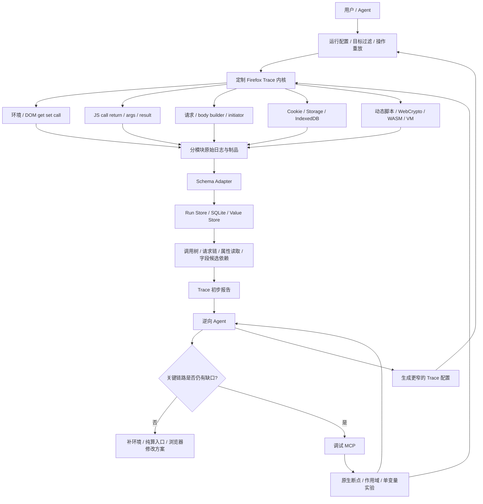
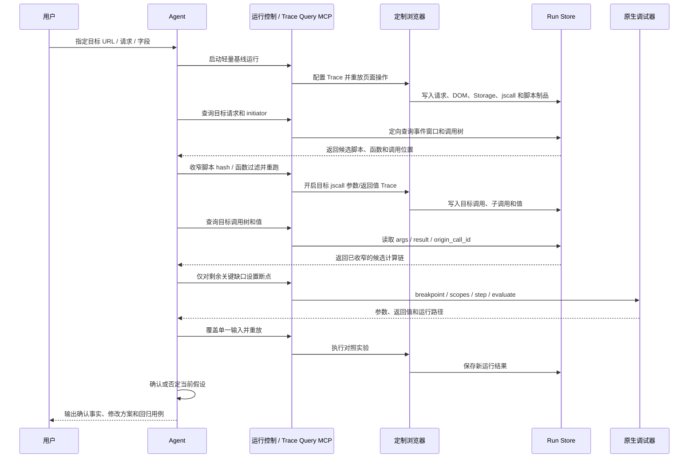
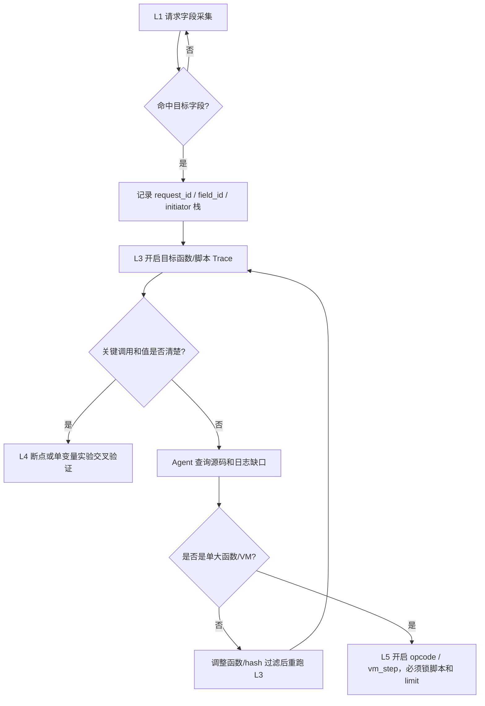
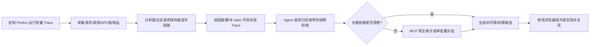

# Firefox 字段级 Trace 与 Agent 辅助逆向项目文档

## 1. 项目目标

本项目核心是魔改 Firefox Trace 内核，让浏览器主动记录环境属性读取、JS 调用和值、请求构造、Cookie/Storage、动态脚本、WASM 和 VM 等逆向关键信息，并尽可能在日志中关联到具体脚本、函数和请求字段。

Agent 和 MCP 是辅助层：Agent 先消费 Trace 已经收窄的结果，只对剩余缺口使用原生断点、作用域检查和单变量实验做交叉验证。目标是用内核 Trace 大幅减少盲目搜索、全站断点和长时间单步，最终更快完成补环境、纯算还原和浏览器修改。

交付边界硬约束：

- 最终交付物是魔改 Firefox 浏览器、日志 schema、启动参数和详细使用说明。
- 不要求用户依赖 Python 分析脚本；仓库内脚本只作为开发期 smoke / 辅助检查工具。
- JD/h5st 只作为测试样本，不能进入浏览器核心、日志 schema、默认配置或默认分析流程。
- 目标字段由用户需求、运行配置或 AI 按使用说明从日志里选择；默认能力必须面向通用网站参数逆向。
- 每个新增内核能力必须编译并 smoke 验证后再继续推进。

最终希望回答三个问题：

1. 最终请求是谁发的？
2. 关键字段是谁算的？
3. 算法依赖了哪些浏览器环境、服务端下发值、Cookie、Storage、随机数和时间？

核心场景：

- 补环境：明确页面实际读取了哪些浏览器环境 API，并知道这些值进入了哪个字段。
- 纯算：定位 sign、token、riskData、fp 等字段的生成函数和输入依赖。
- 风控字段分析：从目标请求字段出发，由 Agent 结合 Trace、断点上下文和对照实验定位计算链。
- 浏览器修改：把已验证的环境读取、原生 API 或运行时行为整理成明确的修改位置和回归用例。

## 快速使用入口

交付给实际使用者的产品手册见 [docs/PRODUCT_MANUAL.md](docs/PRODUCT_MANUAL.md)。
当前待做清单见 [docs/TODO.md](docs/TODO.md)，后续不要把新 TODO 混进本文的大段规划里。
当前提供本地 Web 控制台 v1，用于 runtime control、segment、preset/filter 和日志摘要；
另有静态 [Trace Explorer](viewer/index.html)，可直接打开、选择 `TRACE_DIR`，离线查看
时间线、request/call 关联事件、制品和导出报告。实际证据仍以 `TRACE_DIR` 下的 JSONL
与制品为准。启动入口见 `tools/trace-console.sh` 和产品手册。

当前推荐只使用有头浏览器。launcher 默认启用 automation surface baseline：网页侧
`navigator.webdriver=false`，有头远控提示 UI 隐藏，`about:support` 不暴露
RemoteAgent 监听信息，但 Marionette / RemoteAgent 控制通道保持可用。

### 启动一次轻量发现

```bash
TRACE_DIR=/private/tmp/firefox-trace-case-$(date +%s) \
TRACE_CAMPAIGN_ID=case-001 \
TRACE_QUERY_FIELDS=sign,token,riskData,fp,anti_content,h5st \
tools/run-trace-firefox.sh --trace-preset discover-light 'https://example.com/'
```

启动后先在页面里完成正常操作，让目标请求发出。每轮配置会写入
`TRACE_DIR/manifest.json`，其中 `automation_surface` 默认是 `baseline`。

需要和 Firefox 原始自动化语义对拍时才显式使用 stock：

```bash
tools/run-trace-firefox.sh --trace-automation-surface stock tests/automation-surface.html
```

真实站点如果需要先登录、过验证码、滑块或人工跳转，推荐 paused 启动，目标触发前再开启：

```bash
TRACE_QUERY_FIELDS=sign,token,anti_content,h5st \
tools/run-trace-firefox.sh --trace-preset discover-light --trace-start paused 'https://example.com/'

tools/trace-control.sh "$TRACE_DIR" start target-action
tools/trace-control.sh "$TRACE_DIR" stop after-target
```

`trace-control.sh` 只改本轮 `TRACE_DIR/trace-control.json`，不杀浏览器、不改 profile。

### Preset 选择

| 场景 | preset | 说明 |
|---|---|---|
| 第一次进站、找目标请求和候选脚本 | `discover-light` | 默认选择，轻量抓 XHR/Fetch、DOM signal、Cookie、Storage、script artifact |
| 已找到候选函数，要确认返回值 | `target-return` | 配合 `TRACE_SCRIPT_CONTAINS` / `TRACE_FUNCTION_CONTAINS` / `TRACE_SCRIPT_SHA256` 使用 |
| 要看目标函数输入依赖 | `target-values` | 打开 args/return preview、object preview 和 value_store |
| 需要目标局部调用树 | `deep-causal` | 只在目标脚本已收窄后使用 |
| VM/opcode 场景 | `opcode-window` | 必须锁脚本；可再锁 PC 范围，默认 10,000 条 |

### 推荐多轮流程

1. 首轮 `discover-light`：只配置目标 URL 和 `TRACE_QUERY_FIELDS`，确认目标请求、脚本 URL/hash、DOM/Storage/Cookie 环境读取。
2. 从 `firefox-xhr-*.jsonl` / `firefox-fetch-*.jsonl` 里看 `query_fields`、`body_fields`、`origin_call_id`、`caller_url`。
3. 从 `firefox-script-*.jsonl` 找动态脚本 URL、hash 和落盘路径，选择候选脚本。
4. 二轮 `target-return`：加 `TRACE_SCRIPT_CONTAINS` 或 `TRACE_FUNCTION_CONTAINS`，确认目标函数 return。
5. 三轮 `target-values`：只对确认目标打开 args/object/value_store，看 Cookie、Storage、时间、随机数、环境 API 等输入依赖。
6. 仍有缺口时再用 MCP/断点做单变量验证，不把 Agent 猜测直接写成结论。

### 日志文件速查

| 文件 | 主要用途 |
|---|---|
| `manifest.json` | 本轮目标、preset、surface 模式、profile、Firefox binary、关键环境变量 |
| `firefox-xhr-*.jsonl` | XHR open/send/response、URL query 字段、request body 字段、body value_store |
| `firefox-fetch-*.jsonl` | fetch call/request/response/done、headers、body preview/chunk、query/body 字段 |
| `firefox-js-*.jsonl` | JS enter/return、`call_id` / `parent_call_id`、args/return preview、value_store |
| `firefox-dom-*.jsonl` | navigator/screen/permissions/canvas/WebGL 等页面 API get/call |
| `firefox-storage-*.jsonl` | localStorage/sessionStorage/IndexedDB 相关读写 |
| `firefox-cookie-*.jsonl` | document.cookie、CookieStore、底层 CookieService 生命周期 |
| `firefox-script-*.jsonl` | 静态/动态脚本加载、脚本 hash、artifact 路径 |
| `values/` | 完整长值、请求字段、body、JS return/args 的落盘制品 |

### value_store / sha256 对齐

请求侧字段如果开启 `TRACE_QUERY_FIELD_VALUE_STORE=1`，会在
`query_fields_meta` 或 `body_fields_meta` 写入 `value_store_path`、`sha256`、`size`。
JS 侧打开 `TRACE_JS_VALUE_STORE=1` 后，return/args/object 中的长值也会写
`value_store_path` 和 `sha256`。两个 sha256 一致，才可以把“请求里的字段值”和
“某次 JS 产出的值”作为强证据对齐。

target/deep 场景需要看短字段时，打开 `TRACE_JS_VALUE_METADATA=1`。短字符串会写
`js.value.store` metadata，`stored=false`，包含 `preview`、`sha256`、`call_id`、
`function_name`、`value_role`、`arg_index` 和 `value_path`；是否完整落盘仍由
`TRACE_JS_VALUE_STORE_MIN_BYTES` / `TRACE_JS_VALUE_STORE_MAX_BYTES` 控制。

复合签名字段按通用流程处理：先保存请求字段完整值，再按分隔符或 JSON path 拆分，
然后逐段查 JS metadata。`exact` 命中说明分段本身被函数 return/arg/object 传递；
某个 JS 值的 `sha256` 等于分段，说明该分段是前置材料 digest；只在最终串里
`contains` 则只能说明组装后存在。number/boolean 用
`TRACE_JS_PRIMITIVE_METADATA=1` 纳入同一套 metadata，日志会写
`value_type=number|boolean`、`preview`、`sha256` 和 `value_path`。

### `trace.degraded` 处理

`discover-light` 的 JS boundary ring buffer 每次被 XHR/fetch/storage/cookie/DOM sink
触发 flush 时，会写 `js.boundary.flush_summary`，记录本次 flush 的 `reason`、
`first_seq`、`last_seq`、`flushed`、`dropped_before_flush`、`skipped_by_window`、
`window_capacity`、`storage_capacity` 和 `complete_window`。默认全局窗口由
`TRACE_JS_BOUNDARY_BUFFER_EVENTS` 控制；也可以给关键 sink 单独加大窗口，例如
`TRACE_JS_BOUNDARY_BUFFER_EVENTS_XHR_BODY=16384`、`TRACE_JS_BOUNDARY_BUFFER_EVENTS_FETCH_CALL=12288`。
当 XHR/Fetch 的 URL query 或 XHR body 命中 `TRACE_QUERY_FIELDS` 时，flush reason 会继续带上
字段名，例如 `xhr.body.anti_content`、`fetch.call.token`，可配置
`TRACE_JS_BOUNDARY_BUFFER_EVENTS_XHR_BODY_ANTI_CONTENT=20000` 这类字段级窗口。
`complete_window=false` 表示窗口发生过覆盖或被本次 sink 配置裁剪，必须按候选日志处理。

任何日志里出现 `{"type":"trace.degraded" ...}`，这轮只能用于候选定位，不能用来证明
“没有调用”或“没有依赖”。处理顺序：

1. 收窄 `TRACE_SCRIPT_CONTAINS`、`TRACE_FUNCTION_CONTAINS`、`TRACE_TARGET_MATCH`。
2. 降低 `TRACE_JS_OBJECT_DEPTH`、`TRACE_JS_OBJECT_KEYS`、`TRACE_DOM_PREVIEW`。
3. 关闭暂时无关模块，例如 `FIREFOX_TRACE_STORAGE=0`、`FIREFOX_TRACE_COOKIE=0`。
4. 增大针对性窗口，例如 `TRACE_JS_BOUNDARY_BUFFER_EVENTS_XHR_BODY=16384` 或全局
   `TRACE_JS_BOUNDARY_BUFFER_EVENTS=16384`。
5. 重跑并保留上一轮 manifest，用 campaign 多轮合并证据。

### 常见降载组合

```bash
# 首轮仍爆量：只保留请求和脚本身份，DOM 只抓信号面
TRACE_REQUEST_URL=preview \
TRACE_DOM_MODE=signal \
TRACE_DOM_PREVIEW=none \
TRACE_JS_CAPTURE_VALUES=0 \
tools/run-trace-firefox.sh --trace-preset discover-light 'https://example.com/'

# 二轮只看目标函数 return
TRACE_SCRIPT_CONTAINS='risk' \
TRACE_FUNCTION_CONTAINS='sign,token' \
TRACE_JS_ARGS=none \
TRACE_JS_RET=preview \
TRACE_JS_OBJECT_DEPTH=1 \
tools/run-trace-firefox.sh --trace-preset target-return 'https://example.com/'
```

### 1.1 能力边界

Trace、调试和 Agent 各有明确边界：

| 状态 | 含义 | 是否进入正式报告 |
|---|---|---|
| `hypothesis` | Agent 根据调用邻近、相同值、函数名等生成的下一步调查方向 | 否 |
| `captured` | Trace 或原生调试器直接记录到的运行事实 | 是 |
| `confirmed` | 通过断点、单步、作用域检查或单变量干预确认 | 是 |
| `reproduced` | 浏览器修改或外部实现已在独立运行中复现 | 是 |
| `incomplete` | 当前采集或调试存在缺口，不能下确定结论 | 是，明确标注缺口 |

相同值、调用栈相邻和时间接近可以帮助 Agent 选择下一处断点，但不能直接成为浏览器修改依据。正式报告不输出模糊置信度；结论必须能回到具体运行、事件、脚本 hash、源码位置或验证实验。

### 1.2 非目标

- 不承诺对任意混淆脚本自动还原完整算法。
- 不承诺在开启深度 trace 或 opcode 后仍保持完全相同的时序与 JIT 行为。
- 第一版不实现全站动态污点、完整控制流污点或全局异步因果图。
- 不要求所有请求都捕获 socket/TLS 级原始字节；JS 逆向优先使用逻辑请求 body，确有字节编码问题时再下沉。
- 不把 Agent 假设或一次相同值匹配写入正式结论。
- 不默认采集无关站点、浏览器内部页面或敏感明文。

### 1.3 实现边界

| 范围 | 内容 | 项目态度 |
|---|---|---|
| 已验证可行的能力方向 | DOM get/set/call、jscall、`origin_call_id`、逻辑 HTTP packet、目标脚本过滤、opcode、vm_step、WASM | 作为自研内核 Trace 的能力基线 |
| MVP 核心 | Firefox 内核 Trace、目标过滤、统一 ID、请求/调用/API 关联、脚本与值制品 | 项目第一主线 |
| MVP 配套 | Run Store、Trace Adapter、初步关联分析、Trace Query MCP、操作重放 | 让 Agent 高效消费 Trace |
| 调试验证 | Firefox 原生调试 MCP、断点、作用域和单变量实验 | Trace 链路存在缺口或需要确认时使用 |
| 案例驱动增强 | Worker/Service Worker 关联、raw network、特定 native/WASM 参数、目标 opcode | 常规 Trace 和调试不足时实现 |
| 暂不建设 | 全站污点、通用自动去混淆、完整全局异步图、全站 opcode、纯靠 AI 阅读大日志 | 不作为前置条件 |

## 2. 总体架构



## 3. 核心模块

### 3.1 定制 Firefox Trace 内核

职责：

- 在 C++、WebIDL、SpiderMonkey 和网络/存储边界采集页面不可稳定自报的信息。
- 记录 DOM/BOM 属性读取和值、JS call/return、参数/返回值和脚本位置。
- 将 fetch/XHR/form/body builder、Cookie/Storage 与当前调用上下文关联。
- 支持动态脚本、WebCrypto/WASM 边界以及目标 opcode/vm_step。
- 提供函数名、脚本 URL/hash、请求和 PC 范围过滤，默认轻量、目标命中后深抓。
- 输出 `call_id`、`parent_call_id`、`origin_call_id`、`request_id`、`channel_id` 等关联 ID。

Trace 内核的直接价值是先把范围从“整个页面”压缩到“具体请求、脚本、函数和属性读取”，从源头减少 Agent 动态调试工作量。

### 3.2 Trace 记录、索引与初步分析

职责：

- 接收分模块、分 PID JSONL 和脚本/报文/WASM 制品。
- 建立同步调用树、请求 initiator、`origin_call_id` 上下文和 Cookie/Token 生命周期。
- 将目标请求拆成 headers/query/body/cookie 字段，并关联附近的调用和值事件。
- 输出页面实际读取的环境 API、候选构造函数、动态脚本和多次运行 Diff。
- 为 Agent 提供可查询索引，不让 Agent 直接阅读数百 MB 原始日志。

初步分析可以生成 hypothesis，但正式报告只收录 Trace 直接捕获的事实和后续验证结果。分析器不需要在第一版自动证明所有 JS 表达式的数据依赖。

### 3.3 Agent、MCP 与运行管理

Agent 先使用 Trace 报告定位，再通过 MCP 做定向查询和少量动态调试：

```text
run_start / run_stop / run_replay
browser_navigate / browser_click / browser_type / browser_wait
trace_list_requests / trace_get_request / trace_get_call_tree
trace_find_api_calls / trace_get_script / trace_get_event_window
debug_list_sources / debug_search_source / debug_set_breakpoint
debug_get_scopes / debug_evaluate / debug_step / debug_resume
experiment_override_value / experiment_compare_runs
fact_confirm / report_generate
```

浏览器自动化优先使用 Marionette、WebDriver BiDi 或自定义后端，动态调试优先使用 Firefox RDP。普通页面 JS 注入只作为临时探针。

并非所有 paused frame 都允许直接修改局部变量或返回值。MCP 应探测调试后端能力；不能直接覆盖时，退回到修改可达对象、临时替换目标函数、定向内核开关或重启后重放。所有干预都写入 experiment 记录。

职责：

- 生成浏览器启动环境变量。
- 保存目标 URL、Profile、自动化动作、浏览器 build 和 Trace 开关。
- 为每次运行生成 `run_id`，并允许使用同一 Profile 重放。
- 管理 trace 级别：轻量、目标字段、重型 VM、WASM。
- 管理过滤条件：URL、函数名、脚本 hash、字段名、请求路径。
- 防止日志爆量：limit、采样、ring buffer、自动熔断。
- 管理站点白名单、敏感字段脱敏和日志加密策略。

典型配置：

```json
{
  "targetUrl": "https://example.com/login",
  "logDir": "./traceOut",
  "trace": {
    "jsMode": "boundary",
    "envApi": true,
    "network": true,
    "storage": true,
    "dynamicScript": true
  },
  "filters": {
    "scriptUrlContains": ["risk", "captcha", "fp"],
    "requestUrlContains": ["/risk", "/login", "/verify"],
    "fieldNames": ["sign", "token", "riskData", "fp"]
  }
}
```

### 3.4 核心 Trace 能力优先级

优先级从高到低：

1. 网络请求与 JS initiator 关联。
2. JS 函数 call / return、目标参数和值。
3. 环境 API 读取与 `origin_call_id`。
4. Cookie / Storage 生命周期。
5. 动态脚本落盘。
6. WASM dump。
7. Opcode / vm_step。

本项目的核心工作是在可维护的 Firefox 源码上实现并扩展 DOM get/set/call、jscall、`origin_call_id`、fetch/XHR、Cookie/Storage、opcode、vm_step、WASM 和 HTTP packet，而不是只做外围 MCP。

### 3.5 Trace Adapter 与 Run Store

允许内核继续输出分模块、分 PID 的原始格式。Adapter 将 jscall、DOM、Cookie、Storage、HTTP、WASM 和 VM 日志规范化后写入 SQLite/DuckDB，并为大值、脚本和报文建立外部文件索引。

日志设计原则：

- 一行一个事件，JSONL 格式，便于流式写入和增量分析。
- 原始格式保持可回放；统一字段由 Adapter 补充，不要求第一版同时修改所有内核探针。
- 规范化事件至少带 `run_id`、`event_id`、`seq`、`ts`、`pid`、`process_type` 和 `type`。
- 优先保留已有 `call_id`、`parent_call_id`、`origin_call_id`、`request_id`、`channel_id` 和脚本 hash。
- Realm、Worker、异步任务等 ID 在具体案例需要且现有调用栈不足时再增强。
- 大值不直接塞满主日志，主日志只放 preview、hash、size，完整值落 value store。
- 请求字段必须拆成字段路径，例如 `body.sign`、`headers.x-token`、`cookies.__risk_token`。
- 调查假设单独存储，不写成规范化事实事件。

基础字段：

```json
{
  "schema": "trace.event.v1",
  "run_id": "run_20260724_001",
  "event_id": "evt_10001",
  "seq": 10001,
  "ts": 1720000000000,
  "type": "js.call.enter",
  "level": "info",
  "pid": 1234,
  "tid": 88,
  "process_type": "content",
  "page_id": "page_1",
  "frame_id": "frame_main",
  "browsing_context_id": "bc_42",
  "script_id": "script_app",
  "script_url": "https://example.com/app.js",
  "loc": { "line": 120, "column": 8 },
  "call_id": "call_9527",
  "parent_call_id": "call_9526",
  "request_id": null,
  "channel_id": null,
  "value_id": "val_a1b2",
  "origin_call_id": "call_9527",
  "tags": ["risk", "target"],
  "data": {}
}
```

关键点：

- `call_id` / `parent_call_id` 串同步 JS 调用树。
- `origin_call_id` 表示 DOM、Cookie、Storage 等事件发生时所在的 JS 调用上下文。
- `request_id` 串逻辑请求，`channel_id` 串 Firefox 底层网络通道。
- `origin_call_id` 只能证明事件发生在调用期间，不能单独证明数据依赖。
- `value_id` 表示一次值快照；只有实际需要跨事件追值时才分配。
- `field_path` 标记字段位置，例如 `body.sign`、`headers.x-token`。

日志文件建议拆分：

```text
traceOut/
  run_20260724_001/
    manifest.json              # 本次运行配置、目标 URL、浏览器版本、开始结束时间
    events.jsonl               # 统一主事件流
    fields.jsonl               # 请求字段、响应字段、Cookie、Storage 字段索引
    values/
      sha256_abcd.value        # 大值、完整 body、完整脚本、二进制数据
    scripts/
      script_app_sha256.js     # 静态/动态脚本落盘
    packets/
      req_0001.request.bin
      req_0001.response.bin
    reports/
      summary.json
      investigation.json
      confirmed_facts.json
```

`manifest.json` 示例：

```json
{
  "schema": "trace.manifest.v1",
  "run_id": "run_20260724_001",
  "target_url": "https://example.com/login",
  "started_at": "2026-07-24T13:30:00+08:00",
  "browser": {
    "engine": "firefox",
    "custom_trace": true,
    "version": "custom-dev"
  },
  "switches": {
    "TRACE_ENABLE": "1",
    "TRACE_NETWORK": "1",
    "TRACE_ENV": "1"
  },
  "filters": {
    "url_contains": ["risk", "login", "verify"],
    "field_names": ["sign", "token", "riskData", "fp"]
  }
}
```

## 4. 运行流程



## 5. 字段调查模型

字段调查是本项目最重要的工作流，但不要求 Trace 一次性自动生成完整数据流图。

Agent 从请求字段这个 sink 开始，依次使用 initiator stack、`origin_call_id`、目标 jscall、源码搜索、断点和对照实验向上定位。每找到一段调用链，就记录对应运行、事件、脚本 hash 和源码位置。

目标是点击请求字段后，能看到：

- 字段值是什么。
- 当前定位到哪个构造函数或发送入口。
- 目标 deep Trace 已记录哪些参数、返回值和子调用。
- 哪些关键局部变量或依赖已由 Agent 断点交叉验证。
- 哪些环境值、Cookie、Storage 或响应值已通过干预确认会影响字段。
- 是否依赖服务端挑战。
- 是否可纯算。
- 是否需要补环境。
- 当前还缺哪一步，下一轮应在哪个函数或 PC 加 Trace。

```mermaid
flowchart LR
  Env[navigator / screen / canvas / webgl] --> FP[collectFingerprint]
  Cookie[document.cookie / Set-Cookie] --> Builder[buildPayload]
  Storage[localStorage / IndexedDB] --> Builder
  Resp[/risk/init response nonce] --> Builder
  Time[Date.now / performance.now] --> Builder
  Random[Math.random / crypto.getRandomValues] --> Builder

  FP --> Builder
  Builder --> Encrypt[encrypt / hash / encode]
  Encrypt --> Field[body.riskData / body.sign]
  Field --> Req[POST /risk/verify]
```

字段详情示例：

```text
字段：POST /risk/verify.body.sign

判断：
- 类型：纯算 + 服务端 nonce
- 状态：confirmed
- 可脱离浏览器复现：尚未验证
- 必要输入：nonce、token、timestamp、body 参数

来源：
1. /risk/init.response.nonce
2. localStorage["_risk_token"]
3. Date.now()
4. body.username

计算链：
buildPayload()
  -> normalizeParams()
  -> encrypt()
  -> sha256()

最终去向：
POST /risk/verify body.sign

确认记录：
- run_001：Trace 捕获 body.sign 与 buildPayload initiator，captured
- run_002：断点确认 nonce/token/timestamp 进入 buildSign，confirmed
- run_003：只替换 nonce 后 sign 确定变化，confirmed
- 外部实现尚未对独立样本复现，因此不是 reproduced

待办：
- 导出 normalizeParams 的字段排序规则
- 使用新 nonce 验证外部实现
```

## 6. 风控分析视图

### 6.1 请求视图

展示所有关键请求：

```text
/risk/init
/fp/collect
/captcha/challenge
/risk/verify
/login
```

每个请求展示：

- URL、method、headers、query、body、response。
- JS initiator 调用栈。
- headers/query/body/cookie 字段的构造入口和当前调查状态。
- 与 response、Cookie、Storage、环境读取相关的调用上下文。
- Agent 已设置的断点、验证实验和下一步动作。

字段标签：

```text
sign       纯算 hash/encrypt
riskData   指纹聚合 + 加密
fp         浏览器指纹
nonce      服务端下发
ts         时间
rid        随机数
token      Cookie / Storage
```

### 6.2 环境依赖视图

先展示页面实际读取过的环境，再单独展示已确认进入目标字段的环境：

```text
读取过：
navigator.userAgent          risk.js:120  captured
navigator.webdriver         risk.js:144  captured
screen.width                fp.js:88     captured
canvas.toDataURL            fp.js:210    captured

已确认影响 body.riskData：
navigator.userAgent         run_011 单变量覆盖  confirmed
screen.width                run_012 断点+覆盖    confirmed

尚未确认：
canvas.toDataURL            下一步在 encryptFP 返回处断点
```

用途：

- 判断补环境最小集合。
- 选择下一轮断点和覆盖实验。
- 判断哪些 API 是风控重点。

### 6.3 Cookie / Token 生命周期

展示每个 token 的来源和去向：

```text
__risk_token
  12:01:03  Set-Cookie from /risk/init
  12:01:04  document.cookie read by buildPayload()
  12:01:05  used in header x-risk-token
  12:01:06  refreshed by /risk/verify response
```

需要区分：

- 服务端 Set-Cookie。
- JS document.cookie 写入。
- HttpOnly Cookie。
- localStorage token。
- sessionStorage token。
- IndexedDB token。
- 内存变量 token。

### 6.4 风控时间线

```mermaid
flowchart TB
  A[页面加载] --> B[加载 fp/risk/captcha 脚本]
  B --> C[读取环境指纹]
  C --> D[请求 /risk/init]
  D --> E[获得 nonce / challenge]
  E --> F[生成 fp / riskData]
  F --> G[上报 /fp/collect]
  G --> H[用户点击登录]
  H --> I[生成 sign / token]
  I --> J[请求 /login]
  J --> K{是否触发验证码}
  K -->|是| L[/captcha/challenge]
  K -->|否| M[登录成功]
```

用途：

- 看清风控流程顺序。
- 区分前置初始化请求和最终业务请求。
- 判断字段是否依赖用户行为。
- 判断字段时效性。

### 6.5 Agent 对照实验

Diff 是 Agent 的验证工具，不是固定要求每个目标都执行完整实验矩阵。只有调用链仍有歧义、字段变化来源不清或准备修改浏览器时，才进行针对性实验。

推荐实验矩阵：

| 实验 | Profile | 服务端挑战 | 时间/随机 | 环境 | 用途 |
|---|---|---|---|---|---|
| 基线重放 | 相同 | 每次重新获取 | 自然变化 | 相同 | 识别稳定值和自然波动 |
| 新 Profile | 全新 | 重新获取 | 自然变化 | 相同 | 识别 Cookie/Storage 身份状态 |
| 固定时间随机 | 相同 | 尽量复用 | 固定 | 相同 | 判断时间和随机依赖 |
| 单环境变量 | 相同 | 条件一致 | 固定 | 每次只改一项 | 判断 UA、时区、屏幕等因果影响 |

Agent 应优先设计最小实验，例如只覆盖一个 getter、只替换一个函数返回值或只固定时间。实验记录保存修改项、操作脚本、目标请求和前后字段值。

```text
字段       第一次      第二次      判断
ts         变化        变化        时间
nonce      变化        变化        服务端挑战
uaHash     不变        不变        指纹
canvas     不变        不变        指纹
randomId   变化        变化        随机
sign       变化        变化        依赖 ts/nonce/random
```

普通 Diff 只产生调查假设；断点观察或单变量干预成功后才能标记为 `confirmed`。

## 7. 采集层设计

### 7.1 轻量内核 Trace 基线

第一轮运行的目标是找到“目标请求在哪里构造、由哪个脚本和调用栈发起”，不是一次抓全站所有函数和值。

默认采集：

- DOM/BOM 环境 API 的 get/set/call、参数、返回值和 JS stack。
- fetch、XHR、form、WebSocket 的逻辑请求内容和 initiator。
- Cookie、localStorage、sessionStorage、IndexedDB 的读写及当前 `origin_call_id`。
- 动态脚本、脚本 URL/hash 和必要制品。
- 轻量 jscall 或仅调用汇总；全站详细参数默认关闭。

内核采用启动时环境变量开关、分 PID 日志、目标函数/脚本/hash 过滤、浅序列化、解释器/Baseline tier 区分和 `limit_reached` 哨兵。

页面 JS hook 只在下列情况下作为 Agent 临时探针：

- 内核暂未覆盖某个 API，且目标站允许快速验证。
- Agent 需要短期覆盖某个返回值或记录特定业务对象。
- 验证完成后会用原生断点或内核 Trace 复核。

临时探针必须记录安装方式和可能的行为影响，不进入默认采集预设。

### 7.2 Agent / MCP 交叉验证层

原生调试器负责 Trace 不适合完成的交互式工作：

- 列出和搜索静态、eval、Blob、module、Worker 脚本。
- 按 URL、hash、源码位置和条件设置断点。
- 查看函数参数、局部变量、closure、`this` 和返回值。
- 单步进入/跳出、黑盒无关脚本、暂停异常和 attach Worker。
- 临时覆盖单个 getter、变量或函数返回值，随后重放相同操作。

优先复用 Firefox RDP；导航和用户操作可由 Marionette、WebDriver BiDi 或自定义自动化后端执行。MCP 对 Agent 提供统一工具，不让 Agent 处理底层协议差异。

### 7.3 核心内核 Trace 建设

这是项目的主要工程工作。优先在 Firefox / SpiderMonkey 实现高频逆向能力：

- JS 函数 call / return trace。
- JS value 序列化。
- DOM/BOM get/set/call 的参数、返回值、对象信息和 JS stack。
- fetch/XHR/form/body builder 与当前 call ID。
- CookieService Set-Cookie 来源。
- Storage / IndexedDB 底层读写。
- Worker / Blob / dynamic script 来源。
- WebCrypto 和 WASM 的调用边界、输入输出和制品。
- 统一的脚本 URL/hash、函数过滤、浅/深值和熔断机制。

高成本能力在常规 Trace 无法定位具体问题时再开启或增强：

- opcode / operands / stack trace 和 vm_step。
- Necko 原始网络字节、压缩前后内容和精确编码。
- 目标 Worker、Promise job 或 postMessage 的额外关联 ID。
- 特定 native/WASM 内部参数和内存变化。
- 目标范围的数据标签或字节码插桩。

优点：

- 相比页面注入减少部分 JS 层可观测改动，但仍不承诺不可检测。
- 能拿到底层真实数据。
- 能关联 HttpOnly Cookie、网络、WASM、JS 引擎细节。

缺点：

- 工程量大。
- 编译调试成本高。
- 多进程关联复杂。
- 日志量和性能压力大。

### 7.4 Firefox 多进程关联

Fission 下，页面 JS、Cookie 和网络通道可能不在同一进程。第一版优先关联调试中最常见的 content/parent 事件：

- `BrowsingContextId` / `WindowGlobal`：页面和 frame 身份。
- `request_id`：从 JS API 侧创建的逻辑请求。
- `channel_id` / `nsIChannel` / `LoadInfo`：底层请求、重定向和缓存命中。

已有 channel ID + SavedFrame initiator 能解决多数请求定位。只有遇到 Service Worker、重定向或 Worker 请求无法归属时，再补 `navigation_id`、`ipc_id` 或专用 actor，不把完整跨进程因果系统设为 MVP 前置条件。

### 7.5 脚本与制品谱系

所有参与执行的代码都应可追溯：

- 保存用于逆向的响应内容、charset、URL、响应头和 sha256；需要分析压缩、multipart 或精确签名字节时再保存原始字节。
- 保存 source map URL、source map 文件及映射后的源码位置。
- eval、Function、dynamic import、Blob、Worker 脚本记录父脚本、创建调用和内容 hash。
- WASM 按需保存模块、imports/exports、实例 ID 和 JS/WASM 边界调用。
- 同内容不同 URL、同 URL 不同内容分别分配 `script_id`，不以 URL 作为脚本身份。

## 8. 低干扰设计

风控站对时序敏感，trace 必须默认轻量。

策略：

- 默认浅序列化。
- 按 URL / 函数名 / hash / 字段名过滤。
- 命中目标后再深抓。
- 日志异步写入。
- ring buffer。
- 单模块 limit。
- 文件大小自动熔断。
- 采样模式只用于统计类事件；请求生命周期和目标调用不得随机丢弃。
- 不轻易禁用 JIT。
- 每 N 条 flush，避免崩溃丢日志。
- 超限时优先关闭当前高压模块并 flush，默认不杀浏览器。
- 每次运行记录 trace 自身耗时、丢弃事件数、熔断原因和页面关键性能指标。

原则：

```text
默认轻，命中后重。
先收窄，再深抓。
先字段，再函数，再 opcode。
```

参数逆向的默认执行流必须按“两轮 trace”设计：

1. 首轮使用脚本级/轻量 trace，不要求用户预先知道函数名。保留请求、DOM/XHR/fetch、Cookie/Storage、JS 调用边界、`origin_call_id`、脚本身份和长字符串落盘线索。
2. AI/用户按使用说明从目标字段、请求 query/body、Storage/Cookie、完整 `value_store`、`bytes_hex` 和高熵字符串反推候选脚本/函数，再配置下一轮 trace。仓库内脚本只作为开发期 smoke/辅助工具，不是最终交付依赖。
3. 二轮只对候选脚本/函数开启 args、return、object preview、`value_store` 等深抓能力。
4. limit、sample、hot-function throttle 只作为保险丝，不能作为主分析策略；命中上限必须写 `trace.degraded`，日志不能静默截断。
5. 仍看不清时再升级 opcode / jsvmp；opcode 必须先锁定脚本、函数或 PC 窗口，不做全站 opcode。

因此，过滤关键词是第二轮和应急定位手段，不是首轮前置条件。首轮通用 trace 的目标是让用户拿到一份足够完整的执行轮廓，再由 AI/用户按使用说明给出可验证的收窄方向。

采集分层：

| 层级 | 名称 | 默认 | 适用场景 | 采集内容 |
|---|---|---|---|---|
| L0 | 元信息 | 必开 | 所有运行 | manifest、页面、脚本、基础时间线 |
| L1 | 字段 / 请求 | 默认开 | 常规风控分析 | 请求字段、响应字段、Cookie、Storage、initiator、`boundary` JS 调用 |
| L2 | 环境依赖 | 默认开 | 补环境 | navigator、screen、canvas、webgl、date、random、performance |
| L3 | 目标函数/脚本 Trace | 命中后开 | 字段定位 | 指定函数、URL/hash 的参数、返回值和子调用 |
| L4 | Agent 调试验证 | 条件开 | 交叉验证 | 断点、作用域、覆盖值、操作重放 |
| L5 | opcode / vm_step | 手动开 | jsvmp / 自建 VM | bytecode pc、opcode、operands、栈顶、slot、分支 |

默认只开 L0-L2，其中 JS 使用 `TRACE_JS_MODE=boundary`。Trace 命中目标请求后自动或由 Agent 配置 L3，将 JS 模式升级为 `target` 或 `deep`，用连续运行日志先定位计算函数和值；L4 只验证关键依赖或补 Trace 缺口。L5 只能在明确 jsvmp、控制流平坦化或单大函数看不清时开启。

Agent 升级策略：



VM 特征：

- 一个大函数内部循环次数极高。
- `while/switch` 派发结构明显。
- 大量 `GetElem` 读取字节数组或字符串。
- 函数名、属性名高度混淆，源码级调用树只有少数节点。
- 目标字段返回值来自单个黑盒函数，L3 看不到中间语义。
- 多次运行出现脚本 PC 漂移或 opcode 序列稳定但源码语义不清。

opcode 开启硬性条件：

- 必须设置 `TRACE_OPCODE_SCRIPT_CONTAINS` 或 `TRACE_SCRIPT_SHA256`。
- 必须设置 `TRACE_LIMIT_FILE_MB`。
- 必须配置按模块降级策略并在超限时 flush。
- 只有需要栈值时才开 stack/full value。
- 优先先开 operands，不直接开 full stack。

推荐升级路径：

```text
请求入口不清楚 -> initiator + origin_call_id
字段计算不清楚 -> 目标函数调用 Trace
关键依赖需确认 -> 原生断点 + 单变量实验
目标函数太大 -> 指定脚本 deep
脚本像 VM -> opcode operands
需要看 VM 栈/寄存器槽 -> opcode stack
需要标记已定位 dispatcher 的每次 native loop 迭代 -> vm_step
```

### 8.1 JIT 与 opcode 模式

SpiderMonkey 启用 Baseline/Warp 等 JIT 后，不会稳定地逐条执行原始 JS bytecode。opcode trace 会改变优化、性能和时序，不能描述为“低干扰”。运行模式必须明确分开：

| 执行模式 | JIT | 采集内容 | 用途 |
|---|---|---|---|
| `jit` | 保留 | best-effort 函数边界；参数/返回值只对未内联或目标 deopt 的函数可靠 | 常规定位，默认 |
| `target-interpreter` | 显式解释器调试；当前实现为运行级解释器路径，后续再细化到目标脚本/tier-pin | 更可靠的目标函数边界、参数/返回值和 bytecode/operand | 已收窄后的混淆函数深抓 |
| `opcode` | 目标范围解释执行 | pc、opcode、operand、可选栈值 | VM 指令流还原 |

JIT inline 后可能不存在独立、可观测的函数调用边界。事件应记录 `execution_tier`、`inlining_status`、`capture_status`、`parent_status` 和 `deopt_reason`；缺失的边界或值必须显式标记，不能把 best-effort 调用树展示成完整调用树。

manifest 必须记录执行模式、JIT 配置、目标脚本、是否 deopt、opcode 范围以及相对无 trace 基线的耗时变化。不同模式的结果可以互相佐证，但不得假设事件序列完全等价。

### 8.2 熔断与降级

推荐降级顺序：`stack/full value -> operand -> target call -> field/request`。达到事件或文件上限时写入 `trace.degraded` 事件，包含关闭模块、最后完整 seq、丢弃数量和原因。`TRACE_KILL_ON_LIMIT` 只作为显式调试选项，不进入推荐预设。

## 9. Trace 分析与 Agent 验证输出

Trace 分析器先输出请求链、调用树、环境读取、字段候选来源和制品定位；Agent 通过 MCP 查询并验证其中影响最终修改的关键依赖。

正式结论必须标记 `captured`、`confirmed`、`reproduced` 或 `incomplete`，并引用运行、事件、脚本 hash、源码位置或实验记录。`hypothesis` 只保存在调查记录中，不进入浏览器修改报告。

### 9.1 请求链分层

```text
初始化层：
- /risk/init
- /fp/config

指纹层：
- /fp/collect

挑战层：
- /captcha/challenge

业务层：
- /login
- /order/create
```

### 9.2 字段来源报告

```text
POST /login.body.sign
- 状态：confirmed
- 来源：body 参数 + nonce + token + ts
- 计算函数：buildSign -> encrypt -> sha256
- 确认方式：断点参数检查 + 替换 nonce 后重放
- 下一步：独立样本复算，成功后升级为 reproduced
```

### 9.3 补环境建议

```text
riskData 已确认依赖：
- navigator.userAgent：confirmed, exp_11
- screen.width / height：reproduced, exp_12

已读取但未确认：
- canvas.toDataURL
- WebGL vendor / renderer
- timezone

修改建议：
- 固定 UA、屏幕、时区。
- 保持 localStorage token 生命周期。

下一轮调查：
- 在 canvas/WebGL 聚合函数返回处断点并分别覆盖输出。
```

### 9.4 纯算还原建议

```text
候选入口：
1. buildSign app.js:12453，confirmed
2. encrypt vendor.js:8812，captured
3. sha256 crypto.js:230，hypothesis，待断点确认

必要输入：
- nonce from /risk/init
- token from localStorage
- timestamp
- normalized body

代码骨架：
- fetch /risk/init 拿 nonce
- 读取或生成 token
- normalize body
- sha256/encrypt 输出 sign
```

### 9.5 复现验证报告

纯算候选只有通过独立测试向量才标记为 `reproduced`：

```text
入口：buildSign(body, nonce, token, timestamp)
样本：当前分析样本 + 1 个独立验证样本
输出：浏览器值与外部实现逐字节一致
未解决输入：无
环境前提：UTF-8、字段按 code point 排序、timestamp 为毫秒
状态：reproduced
```

报告同时导出入口位置、脚本 hash、必要输入及来源、序列化规则、固定/动态状态、测试向量和失败差异。无法在独立样本复现时保持 `confirmed`；关键输入或路径仍缺失时标记为 `incomplete`，不得输出“已还原”。

## 10. 开发阶段

### Phase 0：Firefox Trace 内核基线

目标：

- 在 Firefox 内核实现 DOM/BOM get/set/call、值和 JS stack。
- 实现逻辑请求、body builder、initiator、Cookie/Storage/IndexedDB Trace。
- 实现轻量 jscall、目标函数/脚本/hash 深抓和动态脚本落盘。
- 建立 run ID、call/origin/request/channel ID、分 PID 日志、limit 和 flush。

产物：

- 可编译的 Firefox patch、Trace recorder、开关体系和基础 demo-site。
- 能从请求定位 initiator，并从 API/Storage 事件回到当前 JS 调用的日志。

验收：仅看 Trace 就能把一个目标字段收窄到具体请求、脚本和候选构造函数，并列出该调用上下文读取过的环境/状态值。

### Phase 1：Trace Adapter、Run Store 与初步分析

目标：

- 接收分 PID、分模块 JSONL 和脚本、报文、WASM 制品。
- 规范化 DOM、jscall、Cookie、Storage、HTTP 和 VM 日志。
- 构建请求链、同步调用树、环境读取视图、Token 生命周期和候选字段链。

产物：

- Adapter、SQLite/DuckDB Run Store、基础分析器和查询 CLI。
- summary、investigation、scripts、values 和 packet 索引。

验收：无需遍历原始大日志即可按请求、脚本、call ID、API 和字段取回完整相关窗口。

### Phase 2：Agent / MCP 调试集成

目标：

- 启动/停止 Firefox、选择 Profile、传入 Trace 开关并重放页面操作。
- 将 Trace Query 暴露给 Agent，Agent 先读取 Trace 初步报告。
- 接入 Firefox RDP 的 source、breakpoint、pause、scope、evaluate、step 和 Worker 能力。
- 将断点位置绑定到脚本 URL/hash 和 run_id。
- 对 Trace 尚未确认的关键输入执行断点或单变量实验。

产物：

- MCP server、浏览器控制、Trace Query、Native Debugger 工具和调试会话记录。
- 可保存和重放的操作脚本。
- 断点、作用域快照和 evaluate 结果索引。

验收：Agent 使用 Trace 给出的脚本和函数位置直接设置断点，确认一个关键依赖并恢复页面运行。

### Phase 3：Agent 调查闭环

目标：

- 实现“基线、收窄、断点、验证、报告”状态机。
- 优先通过轻量 Trace -> 目标深 Trace 获取证据，动态调试只补关键缺口。
- 分离 hypothesis 与 captured/confirmed/reproduced 事实。
- 实现最小单变量实验和多次运行请求对齐。

产物：

- investigation.json、confirmed_facts.json 和修改方案模板。
- 实验前后字段 Diff、操作记录和证据引用。

验收：Agent 能对一个 demo 字段给出已确认入口、输入、环境依赖和可重放验证记录。

### Phase 4：automation / fingerprint surface

目标：

- 优先处理浏览器底层自动化可见面，让 Agent/WebDriver/headless 相关 surface 可配置。
- 建立 stock Firefox vs trace Firefox 对拍页和差异报告。
- 将 surface 模式写入 `manifest.json`，便于区分 stock、baseline 和后续细分模式。
- 修正 trace/profile/launcher 自身引入的异常，不绑定任何站点规则。

第一批范围：

- `navigator.webdriver`、Marionette / RemoteAgent running 页面可见面。
- 有头浏览器远控提示 UI、窗口/focus、GPU/WebGL、权限和事件时序差异。
- 自动化 profile/prefs、窗口尺寸、plugins、languages 和 permissions 默认值。
- `TRACE_AUTOMATION_SURFACE=stock|baseline` 运行模式。

当前第一步已落地：

- `TRACE_AUTOMATION_SURFACE=baseline` 为 launcher 默认值，浏览器底层页面 API
  默认隐藏 `navigator.webdriver`，有头窗口默认隐藏远程控制提示 UI，`about:support`
  默认不展示 RemoteAgent 监听信息。
- `TRACE_AUTOMATION_SURFACE=stock` 保留 Firefox 原始 `navigator.webdriver`
  、远控 UI 和 RemoteAgent 排障页语义，用于 stock/trace 对拍。
- 该模式不关闭 Marionette、RemoteAgent 或 WebDriver/BiDi 控制通道，只压平页面
  或用户可见 surface。
- trace profile 默认降低 Remote Settings 日志噪声并延长后台轮询间隔，避免
  浏览器 chrome 后台任务污染启动日志；这不修改网页可读的 `navigator`、screen、
  WebGL、UA、语言或时区值。
- trace baseline 下 Remote Settings 后台 startup bundle、timer poll 和 broadcast poll
  默认 no-op；本地 packaged dump 读取保留，避免浏览器后台网络/console 噪声影响运行。
- trace baseline 下搜索引擎图标 Remote Settings attachment 缺失会安静失败，并跳过
  idle 后台下载；`stock` 模式保留原始日志和更新行为。
- `tests/automation-surface.html` 作为本地对拍页，采集 webdriver、UA/app、OS、
  languages、plugins、permissions、screen/window、visibility 和 WebGL/GPU 等页面可见值。

验收：本地测试页能输出 automation / fingerprint surface 对拍报告；真实页面 smoke
中 manifest 明确记录 surface 模式，trace 日志仍能正常采集请求、JS、DOM、Cookie
和 Storage。

### Phase 5：深度 Trace 能力

目标：

- 完善 WebCrypto、WASM、Worker、Blob、跨进程请求和动态代码边界。
- 增强目标函数参数/返回值、对象预览和值落盘。
- 案例需要时补 Necko/raw bytes、异步关联或目标范围数据标签。

产物：

- Firefox/SpiderMonkey 深度 Trace patch 和对应开关。
- 每个增强项的触发案例和回归测试。

### Phase 6：高级 VM / WASM

目标：

- opcode trace。
- vm_step。
- WASM dump。
- 反爬 VM 分析。

产物：

- opcode 日志。
- VM 指令流。
- WASM imports / exports / disasm。

验收：明确记录解释执行、deopt 和 trace 开销；目标 VM 样例能导出稳定的受限指令窗口，不要求全站 opcode。

### Phase 7：浏览器修改与验证

目标：

- 根据 confirmed 事实生成 WebIDL、DOM、SpiderMonkey 或网络层修改说明。
- 使用相同 Profile 和操作脚本执行修改前后 A/B。
- 将成功复现的结论升级为 reproduced。

产物：

- 修改清单、适用 host/frame/script 范围、patch 和回归运行记录。

### Phase 8：可选桌面控制台

目标：

- 配置 trace、管理运行记录并展示 Agent 调查状态。
- 支持从请求字段逐步升级到目标函数、目标脚本和 opcode。

产物：

- Electron 控制台、运行对比、断点记录、时间线和制品查看器。
- 导出可复现实验配置、CLI 命令和分析报告。

## 11. 推荐目录结构

```text
自建 trace/
  README.md
  docs/
    architecture.md
    event-schema.md
    investigation-model.md
    firefox-correlation.md
    trace-switches.md
    analysis-ui.md
    security.md
  schemas/
    manifest.schema.json
    event.schema.json
    report.schema.json
  packages/
    browser-patches/      # Firefox / SpiderMonkey Trace 核心
    trace-recorder/       # 分模块 JSONL、值、脚本和报文输出
    trace-adapters/       # 分模块日志规范化
    run-store/            # SQLite/DuckDB 与大值/脚本/报文索引
    trace-analyzer/       # 可选开发辅助，不作为最终交付依赖
    mcp-server/           # Agent 的统一控制与查询入口
    browser-control/      # Marionette / BiDi / 自定义后端操作重放
    debugger-rdp/         # Firefox 原生调试器适配
    agent-workflow/       # 基线、收窄、断点、验证状态机
    cli/                  # 采集、查询、调试命令
    console/              # Electron 控制台，后期实现
    viewer/               # 可视化 UI
  examples/
    demo-site/
    traces/
    reports/
  tests/
    schema/
    correlation/
    overhead/
```

## 12. 最小可行闭环

第一版先跑通 Agent 调试闭环：



第一版成功标准：

- 能点开 `/login` 或 `/risk/verify` 请求。
- Trace 能直接给出请求 initiator、相关脚本、同步调用树和上下文中的环境/状态读取。
- 目标 deep Trace 能记录候选构造函数的参数、返回值和值预览。
- Agent 基于 Trace 已收窄的位置设置断点，而不是从全站盲查。
- 能保存操作脚本并完成一次单变量覆盖重放。
- 能把调查假设与 captured/confirmed/reproduced 事实分开。
- 能输出一个带运行记录、源码位置和验证步骤的浏览器修改建议。
- 常规字段链由 Trace 主动定位；Worker、深层 WASM、VM 或精确网络字节按目标案例继续扩展。

## 13. 自研开关体系

开关命名建议统一使用 `TRACE_` 前缀，避免绑定某个现有工具。第一版通过环境变量传入，由 MCP `run_start` 根据调查目标生成；桌面 UI 只是后续可选入口。

### 13.1 总开关

| 开关 | 值 | 默认 | 说明 |
|---|---|---|---|
| `TRACE_ENABLE` | `1` / `0` | `0` | 总开关 |
| `TRACE_RUN_ID` | 字符串 | 自动生成 | 本次运行 ID |
| `TRACE_OUT_DIR` | 目录 | `./traceOut` | 输出目录 |
| `TRACE_TARGET_URL` | URL | 空 | 目标 URL，写入 manifest |
| `TRACE_PROFILE` | `light` / `field` / `deep` / `vm` | `field` | 预设采集强度 |
| `TRACE_INTERNAL` | `1` / `0` | `0` | 是否记录浏览器内部页面和扩展噪声 |

### 13.2 过滤开关

| 开关 | 值 | 默认 | 说明 |
|---|---|---|---|
| `TRACE_URL_CONTAINS` | CSV | 空 | 只重点分析 URL 命中的请求/脚本 |
| `TRACE_SCRIPT_CONTAINS` | CSV | 空 | 只深抓命中脚本 |
| `TRACE_SCRIPT_SHA256` | CSV | 空 | 按脚本 hash 深抓 |
| `TRACE_FIELD_NAMES` | CSV | `sign,token,riskData,fp` | 目标字段名 |
| `TRACE_REQUEST_CONTAINS` | CSV | 空 | 目标请求路径 |

`TRACE_PROFILE` 是一组默认配置；显式设置的 `TRACE_JS_MODE`、body、WASM 或 opcode 开关优先于 profile 默认值。

配置原则：默认值只是一套安全起步配置，不是能力边界。任何会影响覆盖范围、日志量或页面时序的策略都要保留用户可调入口：DOM 默认只抓信号面，但可以用 `TRACE_DOM_MEMBERS` / `TRACE_DOM_INTERFACES` 扩展，或者用 `TRACE_DOM_MODE=all` 全量抓；JS 默认轻量和 return-only 优先，但 `this/args/return/object/value_store/buffer/limit` 都必须能显式调整。分析某个参数时，首轮不应要求用户预先知道函数名或 hash；过滤条件只作为二轮深抓的收窄手段。

CSV 过滤支持两种写法：`token` 表示 substring 匹配，`=token` 表示精确匹配。`TRACE_TARGET_MATCH=auto` 下，脚本 URL、函数名、script sha256 三个维度中所有已配置维度都必须命中；只配置一种时按单条件命中。`any` 只用于临时放宽排查，日志会明显变多。

### 13.3 JS 调用开关

| 开关 | 值 | 默认 | 说明 |
|---|---|---|---|
| `TRACE_JS_MODE` | `off` / `boundary` / `target` / `deep` | `boundary` | JS Trace 模式，见下表 |
| `TRACE_JS_EARLY_SCRIPT_FILTER` | `1` / `0` | target/deep 默认 `1` | 配置脚本过滤时，非目标脚本在函数名/hash/value 采集前提前跳过，降低真实页卡死风险；设 `0` 保留更完整 parent/origin 栈 |
| `TRACE_JS_PRUNE_NON_TARGET_FUNCTIONS` | `1` / `0` | target/deep 默认 `1` | 目标脚本内函数名/hash 不命中的热函数不维护 call_id/current-stack，降低混淆脚本卡死风险；设 `0` 保留完整目标脚本内函数父子栈 |
| `TRACE_JS_DEEP_NATIVE` | `1` / `0` | `1`，`deep-causal` preset 为 `0` | deep 目标后代是否记录 native/builtin 调用。关闭后仍保留自定义 JS 子调用和目标返回，避免 `call/push/pop/charCodeAt` 等爆量；需要低层字符/数组过程时显式开回 `1` |
| `TRACE_JS_DEEP_SELFHOSTED` | `1` / `0` | `1`，`deep-causal` preset 为 `0` | deep 目标后代是否记录 self-hosted 调用；关闭用于真实站首轮深抓降噪 |
| `TRACE_JS_DEEP_SUPPRESS_FUNCTIONS` | CSV | 空 | deep 目标后代中按函数名额外抑制记录，支持 `=name` 精确匹配；命中时会写一次 `trace.suppressed` 通知 |
| `TRACE_JS_THIS` | `none` / `preview` | `none` | `target/deep` 模式是否采集 `this`；默认关闭，减少对象展开副作用 |
| `TRACE_JS_ARGS` | `none` / `preview` / `full` | `preview` | `target/deep` 模式的参数采集级别 |
| `TRACE_JS_RET` | `none` / `preview` / `full` | `preview` | `target/deep` 模式的返回值采集级别 |
| `TRACE_JS_MAX_ARGS` | 整数，`0` 表示不限 | `64` | 单次函数调用最多 preview 的参数个数 |
| `TRACE_JS_CAPTURE_VALUES` | `1` / `0` | `0` | 是否采集 target/deep 命中函数的 this/args/return |
| `TRACE_JS_BOUNDARY_BUFFER` | `1` / `0` | discover/field 默认 `1` | boundary 调用边界先进入 ring buffer，由 XHR/fetch/storage/cookie/DOM sink 触发 flush |
| `TRACE_JS_TARGET_BOUNDARY_BUFFER` | `1` / `0` | `0` | target/deep 下显式启用同一 ring buffer；适合等待较久的真实页，只把目标 sink 前的调用/return/value_store 窗口写盘 |
| `TRACE_JS_BOUNDARY_BUFFER_EVENTS` | 整数 | `4096` | boundary ring buffer 容量，当前实现最大 `32768`；命中覆盖写 `trace.degraded` |
| `TRACE_JS_BOUNDARY_BUFFER_EVENTS_<REASON>` | 整数 | 空 | 按 sink/字段 reason 覆盖 flush 窗口，reason 转大写并把 `.` 等分隔符变 `_`，例如 `xhr.body` 对应 `TRACE_JS_BOUNDARY_BUFFER_EVENTS_XHR_BODY`，`xhr.body.anti_content` 对应 `TRACE_JS_BOUNDARY_BUFFER_EVENTS_XHR_BODY_ANTI_CONTENT` |
| `TRACE_JS_BOUNDARY_FLUSH_ON` | CSV / `all` | `all` | 限制哪些 sink 触发 boundary buffer flush，例如 `xhr.send,fetch.call,dom.get` |
| `TRACE_JS_STACK` | `1` / `0` | `1` | 记录调用栈 |
| `TRACE_JS_NATIVE` | `1` / `0` | `0` | 是否记录原生 builtin |
| `TRACE_JS_SCRIPT_DUMP` | `1` / `0` | `0` | 将实际记录到的目标/边界脚本源码保存到 `scripts/<sha256>.js` |
| `TRACE_JS_SCRIPT_DUMP_MAX_BYTES` | 整数 | `4194304` | 单脚本 source dump 最大字节数 |
| `TRACE_JS_MAX_VALUE_BYTES` | 整数 | `65536` | 单值最大字节数 |
| `TRACE_JS_OBJECT_DEPTH` | 整数 | `0` | target/deep 下普通对象展开深度 |
| `TRACE_JS_OBJECT_KEYS` | 整数 | `32` | 单个对象最多展开属性数 |
| `TRACE_JS_OBJECT_VALUE_KEYS` | CSV / `all` / `none` | `all` | 对象展开时只读取匹配 key 的属性值；不匹配属性只写 key 和 `value_skipped=key_filter`，避免触发 getter/Proxy/惰性计算 |
| `TRACE_JS_ARRAY_ITEMS` | 整数 | `16` | 数组最多 preview 元素数 |
| `TRACE_JS_TYPED_ARRAY_BYTES` | 整数 | `64` | TypedArray、ArrayBuffer、DataView 最多 preview 字节数 |
| `TRACE_JS_VALUE_STORE` | `1` / `0` | `0` | 将完整长值保存到 `values/` |
| `TRACE_JS_VALUE_METADATA` | `1` / `0` | `0` | 为字符串值写 metadata；target/deep preset 默认开启 |
| `TRACE_JS_VALUE_METADATA_MIN_BYTES` | 整数 | `1` | 字符串 metadata 最小长度 |
| `TRACE_JS_PRIMITIVE_METADATA` | `1` / `0` | `0` | 为 number/boolean 写轻量 metadata；target/deep preset 默认开启 |
| `TRACE_JS_PRIMITIVE_METADATA_MIN_BYTES` | 整数 | `1` | primitive preview 最小长度 |
| `TRACE_JS_VALUE_STORE_MIN_BYTES` | 整数 | 同 `TRACE_JS_DEEP_LONG_STR` | 完整落盘最小长度 |
| `TRACE_JS_DEEP_LONG_STR` | 整数 | `1024` | 长字符串超过该阈值时优先落盘 |
| `TRACE_JS_VALUE_STORE_MAX_BYTES` | 整数 | `2097152` | 单个 value_store 文件最大字节数 |
| `TRACE_JS_LIMIT_EVENTS` | 整数 | `50000` | JS 调用事件上限，命中后写 limit 哨兵 |
| `TRACE_JS_SHALLOW` | `1` / `0` | `1` | 浅序列化，降低时序干扰 |
| `TRACE_JS_SHALLOW_DEPTH` | 整数 | `2` | 浅序列化对象深度 |
| `TRACE_ASYNC_CAUSE` | `1` / `0` | `0` | 目标案例需要时记录 Promise、timer、event、message 关联 |
| `TRACE_REALMS` | `window,frame,worker,worklet` | `window,frame` | 需要采集的 Realm；Worker 按需加入 |

| JS 模式 | 行为 |
|---|---|
| `off` | 不记录 JS 函数调用 |
| `boundary` | 记录 best-effort 函数边界和父子关系，不采参数/返回值；JIT inline 可能产生缺口 |
| `target` | 只对函数名、脚本 URL/hash 等过滤器命中的函数采参数/返回值 |
| `deep` | 对目标函数及其子调用深抓，必须同时配置目标过滤和 limit |

默认保留 JIT，降低真实页面卡死和时序干扰风险。只有显式设置 `TRACE_EXECUTION_MODE=target-interpreter` 时，才把执行压到解释器路径；这个只适合已经收窄到小脚本/小函数后的精确调试。

`target/deep` 下如果配置了 `TRACE_SCRIPT_CONTAINS`，默认启用 `TRACE_JS_EARLY_SCRIPT_FILTER=1`：脚本 URL 不命中的调用不会继续做函数名编码、script hash、value preview 等重活。日志里命中的 JS 事件会带 `early_script_filter=true` 和 `non_target_stack_skipped=true`，表示非目标脚本栈被跳过，`parent_call_id` 只能用于目标脚本内局部链路。如果你需要完整跨脚本 parent/origin 栈，显式设置 `TRACE_JS_EARLY_SCRIPT_FILTER=0`，并相应降低 args/object/value_store 强度。

目标脚本命中后，默认继续启用 `TRACE_JS_PRUNE_NON_TARGET_FUNCTIONS=1`：同一目标脚本内函数名/hash 不命中的高频函数会在过滤判断后直接跳过，不再分配 call_id 或维护 current-stack。命中的 JS 事件会带 `non_target_function_stack_skipped=true`。这个模式适合真实站二轮深抓目标返回值；代价是目标脚本内非目标函数父子栈不完整。需要还原完整函数树时设置 `TRACE_JS_PRUNE_NON_TARGET_FUNCTIONS=0`，同时建议关闭 args/this、降低 object depth、先只抓 return preview。`deep-causal` preset 在关闭 prune 的同时默认设置 `TRACE_JS_DEEP_NATIVE=0` 和 `TRACE_JS_DEEP_SELFHOSTED=0`，先保留自定义 JS 子调用、入参和中间 return；如果 agent 需要继续追 `charCodeAt`、`push/pop`、`Array/String` 这类低层过程，再按候选窗口重跑并显式打开 native/self-hosted。

`discover/field` 的 boundary 模式默认启用 ring buffer：JS call 先缓存，不逐条同步刷盘；XHR/fetch/storage/cookie/DOM 等 sink 发生时 flush 最近窗口。如果出现 `trace.degraded reason=boundary_buffer_overwrite`，说明窗口被覆盖，本轮只能用于候选定位，不能证明链路不存在。

### 13.3.1 DOM Trace 开关

| 开关 | 值 | 默认 | 说明 |
|---|---|---|---|
| `TRACE_DOM_MODE` | `signal` / `all` / `off` | `signal` | `signal` 只记录风控常读 DOM 面；`all` 才全量记录 DOM binding |
| `TRACE_DOM_EVENTS` | CSV / `all` / `none` | `all` | 控制 DOM binding 事件类型：`get,set,call,construct`，也可写完整类型 `dom.get` |
| `TRACE_DOM_PREVIEW` | CSV / `all` / `none` | `all` | 控制 DOM 值预览：`args,value,page,caller`；设 `none` 时仍保留 interface/member/argc/origin_call_id 等轻量结构 |
| `TRACE_DOM_MEMBERS` | CSV | 空 | 额外记录指定 DOM interface/member，例如 `Navigator.userAgent,Document.createElement` |
| `TRACE_DOM_INTERFACES` | CSV | 空 | 额外记录整个 DOM interface，例如 `Navigator,Screen,HTMLCanvasElement` |
| `TRACE_DOM_HOT_MEMBER_LIMIT` | 整数，`0` 表示关闭 | `0` | 单个 `operation/interface/member` 超过阈值后写 `trace.degraded reason=hot_member_limit` |
| `TRACE_DOM_HOT_MEMBER_SAMPLE` | 整数，`0` 表示超限后丢弃 | `0` | 配合热点阈值使用，超限后每 N 次保留 1 条；只作保险丝，不作首轮主策略 |
| `TRACE_DOM_LIMIT_EVENTS` | 整数，`0` 表示不限 | `50000` | DOM 事件上限，命中后写 `trace.degraded module=dom` |

`signal` 默认覆盖 Navigator、Screen、Window 尺寸、Document 状态、Canvas/WebGL、Crypto/SubtleCrypto、Performance、History、Location、Permissions、RTCPeerConnection 等常见风控读取面。覆盖不到的属性不要改浏览器源码硬加死：优先用 `TRACE_DOM_MEMBERS=Interface.member` 或 `TRACE_DOM_INTERFACES=Interface` 临时扩展；需要完整 DOM 噪声时显式开 `TRACE_DOM_MODE=all`。

真实站出现卡顿时，DOM 侧优先按成本降级：先用 `TRACE_DOM_EVENTS=get,call`
保留读取/调用边界；再用 `TRACE_DOM_PREVIEW=none` 关闭 args/value/page/caller
预览；最后才开启 `TRACE_DOM_HOT_MEMBER_LIMIT` / `TRACE_DOM_HOT_MEMBER_SAMPLE`
作为热点保险丝。命中热点或总量上限都会写 `trace.degraded`，该轮日志只能说明候选方向，不能证明链路不存在。

### 13.4 调查关联开关

| 开关 | 值 | 默认 | 说明 |
|---|---|---|---|
| `TRACE_ORIGIN_CALL_ID` | `1` / `0` | `1` | DOM/Cookie/Storage 记录当前 JS 调用上下文 |
| `TRACE_BODY_BUILDER` | `1` / `0` | `1` | 记录 fetch/XHR/form body 构造入口 |
| `TRACE_VALUE_TRACK` | `1` / `0` | `0` | 目标值需要跨事件追踪时分配 `value_id` |
| `TRACE_VALUE_HASH` | `1` / `0` | `1` | 记录 sha256，用于跨运行 Diff |
| `TRACE_VALUE_FULL_STORE` | `1` / `0` | `1` | 大值落 `values/` |
| `TRACE_CALL_SUMMARY` | `1` / `0` | `1` | 轻量统计脚本/函数调用次数，帮助 Agent 收窄目标 |

### 13.5 环境与补环境开关

| 开关 | 值 | 默认 | 说明 |
|---|---|---|---|
| `TRACE_ENV` | `1` / `0` | `1` | 环境 API 读取 trace |
| `TRACE_ENV_GROUPS` | CSV | `navigator,screen,canvas,webgl,date,random,crypto,performance,intl` | 环境组 |
| `TRACE_DOM` | `1` / `0` | `1` | DOM 查询、属性读取、事件 trace |
| `TRACE_EVENT` | `1` / `0` | `1` | 用户事件、定时器、observer |
| `TRACE_CANVAS_IMAGE` | `1` / `0` | `0` | canvas 完整图像落盘，默认关闭 |

### 13.6 网络、Cookie、Storage 开关

| 开关 | 值 | 默认 | 说明 |
|---|---|---|---|
| `TRACE_NETWORK` | `1` / `0` | `1` | fetch/XHR/底层网络 trace |
| `TRACE_FETCH_EVENTS` | CSV / `all` / `none` | `all` | 控制 Fetch 生命周期事件：`call,request,response,done` |
| `TRACE_FETCH_RESPONSE_BODY` | `none` / `preview` / `full` | `none` | Fetch response body 预览；只在显式开启时 clone body stream 并限量读取 |
| `TRACE_FETCH_RESPONSE_BODY_MAX_BYTES` | 整数 | `65536` | Fetch response body 单次最多读取字节数，上限 2 MiB |
| `TRACE_FETCH_RESPONSE_BODY_HEX_BYTES` | 整数 | `64` | `body_bytes_hex` 最多输出字节数 |
| `TRACE_FETCH_RESPONSE_BODY_CHUNK_EVENTS` | 整数 | `4` | Fetch body chunk preview 最多输出事件数，0 表示不限制事件数但仍受 MAX_BYTES 限制 |
| `TRACE_FETCH_RESPONSE_BODY_STORE` | `1` / `0` | `0` | response 阶段 clone 完整且未截断时写入 `values/fetch_body_<pid>_<seq>.txt`；事件带 artifact path 和 SHA-256 |
| `TRACE_FETCH_RESPONSE_BODY_STORE_MAX_BYTES` | 整数 | `65536` | 完整 response artifact 的最大读取量，上限 `67108864`；超过上限不写 partial artifact |
| `TRACE_FETCH_REQUEST_BODY` | `none` / `preview` / `full` | `none` | Fetch request body 预览；显式开启后克隆 InternalRequest body stream，避免消费真实请求体 |
| `TRACE_FETCH_REQUEST_BODY_MAX_BYTES` | 整数 | `65536` | Fetch request body 最多读取字节数，上限 2 MiB |
| `TRACE_FETCH_REQUEST_BODY_HEX_BYTES` | 整数 | `64` | Fetch request `body_bytes_hex` 最多输出字节数 |
| `TRACE_FETCH_REQUEST_BODY_STORE` | `1` / `0` | `0` | 将 Fetch request body 预览片段写入 `values/fetch_req_body_<pid>_<seq>.txt` |
| `TRACE_FETCH_RESPONSE_HEADERS` | `none` / `preview` / `full` | `preview` | 在 `fetch.response` 输出响应头元数据；不读取 body |
| `TRACE_FETCH_RESPONSE_HEADER_NAMES` | CSV | 空 | 只输出命中的 response header 名；空表示输出可见 entries |
| `TRACE_FETCH_RESPONSE_HEADERS_MAX_COUNT` | 整数 | `64` | 单个 `fetch.response` 最多输出 header 条数 |
| `TRACE_FETCH_RESPONSE_HEADER_VALUE_MAX_BYTES` | 整数 | `4096` | 单个 response header value 最大输出字节数 |
| `TRACE_XHR_EVENTS` | CSV / `all` / `none` | `all` | 控制 XHR 生命周期事件：`open,header,send,body,start,done,response` |
| `TRACE_XHR_PREVIEW` | CSV / `all` / `none` | `all` | 控制 XHR 值预览：`header,body,response,detail`；关闭 response 时不复制 `responseText` |
| `TRACE_XHR_REQUEST_BODY` | `none` / `preview` / `full` | `none` | XHR request body bounded preview；支持 string / URLSearchParams 这类可直接观察的 send body，不消费真实请求体 |
| `TRACE_XHR_REQUEST_BODY_MAX_BYTES` | 整数 | `65536` | XHR request body 最多捕获字节数，上限 2 MiB |
| `TRACE_XHR_REQUEST_BODY_HEX_BYTES` | 整数 | `64` | XHR request `request_body_bytes_hex` 最多输出字节数 |
| `TRACE_XHR_REQUEST_BODY_STORE` | `1` / `0` | `0` | 将 XHR request body 捕获片段写入 `values/xhr_req_body_<pid>_<seq>.txt` |
| `TRACE_REQUEST_URL` | `full` / `preview` / `none` | `full` | 控制 XHR/fetch URL 字段输出量；`preview` 写截断 URL 和 size/truncated 元数据，`none` 只写 disabled/size，但仍用完整 URL 拆 `query_fields` |
| `TRACE_QUERY_FIELD_VALUES` | `preview` / `full` / `none` | `preview` | 控制 `TRACE_QUERY_FIELDS` 命中字段在日志中的值输出；`full` 用于二轮精确对齐，`none` 只写 meta |
| `TRACE_QUERY_FIELD_VALUE_STORE` | `1` / `0` | `0` | 将命中的 query 字段完整值写入 `values/`，并在 `query_fields_meta` 写 `value_id/value_store_path/sha256`；XHR 文件名前缀 `qfv_xhr_`，Fetch 文件名前缀 `qfv_fetch_` |
| `TRACE_QUERY_FIELD_VALUE_STORE_MIN_BYTES` | 整数 | `0` | query 字段落盘最小字节数 |
| `TRACE_QUERY_FIELD_VALUE_STORE_MAX_BYTES` | 整数 | `2097152` | query 字段落盘最大字节数，过大时写 `value_store_skipped=too_large` |
| `TRACE_NETWORK_BODY` | `none` / `preview` / `full` | `none` | 请求/响应 body 总开关；具体模块仍可用 Fetch/XHR 专用开关覆盖 |
| `TRACE_NETWORK_RAW` | `1` / `0` | `0` | 精确编码确有需要时保存目标请求/响应原始字节 |
| `TRACE_NETWORK_INITIATOR` | `1` / `0` | `1` | 请求关联 JS 调用链 |
| `TRACE_COOKIE` | `1` / `0` | `1` | Cookie 读写、Set-Cookie 来源和 CookieStorage 底层生命周期 |
| `TRACE_STORAGE` | `1` / `0` | `1` | localStorage/sessionStorage/IndexedDB |
| `TRACE_WS` | `1` / `0` | `0` | 开启 WebSocket 逻辑帧追踪；也可运行时使用 `trace-control.sh ... config --module ws=1` |
| `TRACE_WS_PREVIEW_BYTES` | 整数 | `512` | 文本帧 preview 最大字节数、二进制帧 hex prefix 最大原始字节数；上限 `4096` |
| `TRACE_HTTP_RAW` | `1` / `0` | `0` | parent HTTP response payload raw chunk trace；写 `firefox-http-raw-*.jsonl` |
| `TRACE_HTTP_RAW_EVENTS` | 整数 | `8` | 每个 HTTP channel 最大 raw chunk 事件数，`0` 表示不以事件数限制 |
| `TRACE_HTTP_RAW_MAX_BYTES` | 整数 | `65536` | 每个 HTTP channel 最大累计采集字节数，上限 `4194304` |
| `TRACE_HTTP_RAW_HEX_BYTES` | 整数 | `256` | 每个 chunk 的 `payload_hex` 最大原始字节数，上限 `4096` |
| `TRACE_WASM` | `1` / `0` | `0` | 成功 WASM compile 的模块元数据与 bounded preview，写入 `firefox-wasm-*.jsonl`；也可运行时使用 `trace-control.sh ... config --module wasm=1` |
| `TRACE_WASM_DUMP` | `1` / `0` | `0` | 请求在 `TRACE_WASM_DUMP_MAX_BYTES` 内将完整模块写入 `wasm/<sha1>.wasm` |
| `TRACE_WASM_DUMP_MAX_BYTES` | 整数 | `1048576` | 单模块 dump 最大字节数，上限 `16777216` |
| `TRACE_WASM_PREVIEW_BYTES` | 整数 | `64` | `wasm.module.bytecode_preview_hex` 最大原始字节数，上限 `4096` |
| `TRACE_WASM_MODULE_LIMIT` | 整数 | `32` | 单进程 WASM module 事件最大数，上限 `1024` |
| `TRACE_WASM_INSN` | `1` / `0` | `0` | 输出 bounded `wasm.insn` raw code-section byte 事件 |
| `TRACE_WASM_INSN_LIMIT` | 整数 | `256` | 单模块 code-section byte 事件最大数，上限 `65536` |

当前 Fetch 已实现轻量生命周期事件：`fetch.call` 记录 JS 调用入口、caller、page、query fields 和 body length；`fetch.request` 记录最终 Request 元数据，并可显式开启 request body clone preview/store；`fetch.response` 记录 status、response type、redirect、body size 和 response headers；`fetch.done` 记录结束原因。默认不读取、不 clone Request/Response body，日志写 `body_preview_enabled=false`。显式设置 `TRACE_FETCH_REQUEST_BODY=preview|full` 后，`fetch.request` 会克隆 InternalRequest body stream 后限量读取，失败会写 `body_preview_skipped`，不会消费真实上传 body。显式设置 `TRACE_FETCH_RESPONSE_BODY=preview|full` 后，`fetch.response` 会先尝试 trace-only body clone；如果 response 阶段 body 尚不可读，会写 `body_preview_skipped`。真实响应体可见性主要由 `fetch.body_chunk` 提供：它在 `FetchDriver::OnDataAvailable` 原本复制网络数据到 pipe 的同一轮旁路采样前 N 字节，输出 `body_preview/body_bytes_hex`，不额外读取 stream。XHR request body 需要显式设置 `TRACE_XHR_REQUEST_BODY=preview|full`；开启后 `xhr.body` 会记录 `request_body_size/captured_size/truncated/sha256`，可选写入 `values/xhr_req_body_*`，并从 JSON body 或 form-urlencoded body 中按 `TRACE_QUERY_FIELDS` 抽取 `body_fields/body_fields_meta`。WebSocket 默认关闭；开启后在 `firefox-websocket-*.jsonl` 写入 `websocket.frame` 的 send/recv 逻辑边界、socket id、URL、binary、size 和 bounded preview。二进制 preview 用 hex，Blob/stream send 仅记录大小并将 `preview_available=false`。真实站长 URL/query 日志过大时，可设置 `TRACE_REQUEST_URL=preview` 或 `none` 降低写盘量；这不会影响 `TRACE_QUERY_FIELDS` 从完整 URL 中提取字段。需要把请求中的目标参数与 JS return/value_store 做完整等值对齐时，使用 `TRACE_QUERY_FIELD_VALUE_STORE=1`，或短时间设置 `TRACE_QUERY_FIELD_VALUES=full`；默认 `preview` 只适合候选定位。

`http.raw_chunk` 是 parent HTTP 已读响应块，事件含 frame/top-frame 标识，可与 XHR/Fetch
的同名字段关联；它不是 TCP 包捕获。`wasm.module` 是成功编译的 WASM 模块元数据，optional
dump 受单模块字节上限控制；`wasm.insn` 的 `semantic=raw_code_section_byte` 明确表示它是
原始 code-section 字节，离线反汇编前不应当把它当成已解码 opcode。

当前 Cookie 已实现 API 层和 storage 层两类事件：API 层的 `document.cookie` / CookieStore 事件用于关联页面、caller 和 `origin_call_id`；storage 层的 `cookie.lifecycle` 用于确认实际状态变化原因，包括 delete、overwrite、expired set delete、expired purge、quota eviction 和 removeAll。storage 层不保证有 JS 调用上下文，分析时按 `key/host/path/base_domain/origin_attributes_suffix` 与 API 层、JS trace、请求字段合并。

### 13.7 动态脚本、WASM、VM 开关

| 开关 | 值 | 默认 | 说明 |
|---|---|---|---|
| `TRACE_DYNAMIC_SCRIPT` | `1` / `0` | `1` | eval/new Function/Blob/Worker 脚本落盘 |
| `TRACE_SCRIPT_RESOURCE` | `1` / `0` | preset 默认 `1` | 外部脚本资源加载事件 `script.resource`，记录 URL、page、content-type、charset、source map、resolved source map、headers 和可选 raw artifact |
| `TRACE_SCRIPT_RESOURCE_FILTER` | `web` / `chrome` / `all` | `web` | 控制 `script.resource` 记录范围；默认只抓网页脚本，避免扩展/chrome 脚本噪声 |
| `TRACE_SCRIPT_RESOURCE_CAPTURE` | `1` / `0` | `0` | 缓存外部脚本原始响应字节用于 sha256/artifact；默认关闭 |
| `TRACE_SCRIPT_RESOURCE_STORE` | `1` / `0` | `0` | 将未截断的外部脚本原始响应写入 `scripts/<raw_sha256>.js` |
| `TRACE_SCRIPT_RESOURCE_MAX_BYTES` | 整数 | `4194304` | 单个脚本 raw capture 最大字节数，上限 64 MiB；超过写 `raw_truncated=true` |
| `TRACE_SCRIPT_RESOURCE_HEADERS` | `none` / `preview` | `preview` | 是否输出外部脚本响应头元数据 |
| `TRACE_SCRIPT_RESOURCE_HEADER_NAMES` | CSV | 常用头 | 指定要记录的脚本响应头名，例如 `content-type,sourcemap,x-sourcemap` |
| `TRACE_WASM` | `1` / `0` | `0` | WASM 模块和 imports/exports，命中目标后开启 |
| `TRACE_EXECUTION_MODE` | `jit` / `target-interpreter` / `opcode` | `jit` | JIT 与目标解释执行策略 |
| `TRACE_OPCODE` | `1` / `0` | `0` | JS opcode 级 trace，默认关闭 |
| `TRACE_OPCODE_SCRIPT_CONTAINS` | CSV | 空 | opcode 必须锁单脚本 |
| `TRACE_OPCODE_SCRIPT_LINE` | 整数 | 空 | 可选 JSScript 起始行 pin；与 URL filter 同时匹配 |
| `TRACE_OPCODE_SCRIPT_COLUMN` | 整数 | 空 | 可选 JSScript 起始列 pin |
| `TRACE_OPCODE_SCRIPT_BYTECODE_LENGTH` | 整数 | 空 | 可选 JSScript bytecode length pin |
| `TRACE_OPCODE_PC_RANGE` | `start:end` | 空 | PC 窗口；运行中可更新 |
| `TRACE_OPCODE_LIMIT` | 整数 / `0` | `10000` | 每个 segment 的 opcode 事件上限；`0` 不限，运行中可更新；超限写 `trace.degraded reason=opcode_limit` |
| `TRACE_OPCODE_OPERANDS` | `1` / `0` | `1` | 输出原始 `operand_bytes_hex` 与 bytecode operand format |
| `TRACE_OPCODE_STACK_SLOTS` | `0..8` | `0` | 输出指定数量的栈顶 slot 类型；`opcode-window` preset 默认 `4` |
| `TRACE_OPCODE_STACK_PRIMITIVES` | `1` / `0` | `0` | 对栈顶的 number/boolean/null/undefined 附带原始值；不展开字符串或对象 |
| `TRACE_VM_STEP` | `1` / `0` | `0` | 启用已定位 dispatcher PC 的 `js.vm_step` 标记；运行中可更新 |
| `TRACE_VM_DISPATCH_PC` | 整数 | 空 | 必填；仅此 native JS bytecode PC 写 step；运行中可更新 |
| `TRACE_VM_STEP_LIMIT` | 整数 / `0` | `10000` | 每 segment 的 step 上限；`0` 不限，运行中可更新；超限写 `trace.degraded module=vm_step reason=vm_step_limit` |

`js.vm_step` 是收窄后的 native dispatcher-loop iteration marker，记录 `step_index`、
JSScript identity、`vm_dispatch_pc` 和栈深度。它不自动从 JS 局部变量或数组中解码 VMP 的
virtual opcode / virtual PC；先用 opcode analyzer 确认 dispatcher，再显式传入
`TRACE_VM_DISPATCH_PC`。脚本 identity/tier-pin 是启动级配置；opcode PC window、opcode
limit、vm_step 开关、dispatcher PC 和 step limit 可经 `trace-control config` 热更新。vm_step
只受匹配 JSScript 和自己的 dispatcher PC/limit 限制，不受 opcode 显示 PC window 限制。

`script.resource` 中如果脚本、响应头或完整 raw capture 里的 `sourceMappingURL=`
声明了 source map，会输出 `source_map_url` 和 `source_map_resolved_url`。如果同时开启
`TRACE_SCRIPT_RESOURCE_CAPTURE=1` 和 `TRACE_SCRIPT_RESOURCE_STORE=1`，脚本原始响应会写到
`scripts/<raw_sha256>.js`，事件中的 `raw_sha256` / `artifact_path` 可作为脚本和 map
制品的 join key。source map 文件不由浏览器后台自动下载；需要时由外部工具按
`source_map_resolved_url` 显式抓取，避免 trace 浏览器自己引入额外网络行为。
可运行：

```bash
tools/fetch_source_maps.py "$TRACE_DIR"
```

工具会读取 `firefox-script-*.jsonl`，把 source map 写入 `source_maps/`，并维护
`source_maps/index.jsonl`。如果 `raw_truncated=true`，事件会写
`raw_capture_suggestion`，通常应增大 `TRACE_SCRIPT_RESOURCE_MAX_BYTES` 或收窄
`TRACE_SCRIPT_RESOURCE_FILTER` 后重跑。

### 13.8 性能与熔断开关

| 开关 | 值 | 默认 | 说明 |
|---|---|---|---|
| `TRACE_LIMIT_EVENTS` | 整数 | `5000000` | 总事件上限，0 才表示不限 |
| `TRACE_LIMIT_FILE_MB` | 整数 | `512` | 单次运行最大日志体积 |
| `TRACE_FLUSH_INTERVAL` | 整数 | `256` | 每 N 条刷盘 |
| `TRACE_RING_BUFFER` | `1` / `0` | `1` | 高压事件先进入环形缓冲 |
| `TRACE_SAMPLE_RATE` | `0.0-1.0` | `1.0` | 仅统计类事件采样；因果/生命周期事件不可采样 |
| `TRACE_DEGRADE_ON_LIMIT` | `1` / `0` | `1` | 超限时逐级关闭高压采集并写 `trace.degraded` |
| `TRACE_KILL_ON_LIMIT` | `1` / `0` | `0` | 超限是否杀浏览器，仅显式调试使用 |

### 13.9 安全与数据治理开关

| 开关 | 值 | 默认 | 说明 |
|---|---|---|---|
| `TRACE_ALLOWED_PAGE_HOSTS` | CSV | 目标 URL host | 允许采集的顶层页面和 frame host |
| `TRACE_ALLOWED_SCRIPT_HOSTS` | CSV | 继承 PAGE | 允许保存脚本正文和深度 JS 值的 host |
| `TRACE_ALLOWED_REQUEST_HOSTS` | CSV | 继承 PAGE | 允许保存请求/响应 body、Cookie 和 header 深值的 host |
| `TRACE_EXTERNAL_HOST_DISCOVERY` | `1` / `0` | `1` | 对未授权外部 host 只记录 URL、类型、大小和 hash 元信息，供 Agent 扩充白名单 |
| `TRACE_REDACT` | `1` / `0` | `1` | 对密码、Cookie、Authorization 等敏感字段生成脱敏预览 |
| `TRACE_REDACT_FIELDS` | CSV | `password,passwd,authorization,cookie,set-cookie` | 额外敏感字段 |
| `TRACE_VALUE_ENCRYPT` | `1` / `0` | `1` | 完整值和原始报文加密落盘 |
| `TRACE_VALUE_KEY_PROVIDER` | `auto` / `dpapi` / `keychain` / `secret-service` / `passphrase` / `session` | `auto` | 完整值加密密钥提供方 |
| `TRACE_VALUE_KEY_ID` | 字符串 | 自动生成 | 本次运行密钥标识，不记录明文密钥 |
| `TRACE_VALUE_PASSPHRASE_FILE` | 文件路径 | 空 | passphrase 模式从权限受限文件读取，不通过命令行或普通环境变量传递 |
| `TRACE_VALUE_ENCRYPT_FAILURE` | `skip-full-value` / `abort-run` | `skip-full-value` | 取钥或加密失败时禁止降级为明文 |
| `TRACE_RETENTION_DAYS` | 整数 | `7` | 运行数据默认保留天数 |

页面、脚本和请求白名单分别管理。首轮可以看到外部 CDN、captcha、risk 子域的元信息，但只有 Agent 或用户明确加入对应白名单后，后续运行才保存脚本正文、body、Cookie 或深值。

每次运行生成独立数据密钥，再由 provider 包装：Windows 使用 DPAPI，macOS 使用 Keychain，Linux 使用 Secret Service；`passphrase` 使用权限受限文件提供口令；`session` 仅适合运行期间实时分析，除非另行包装，否则进程退出后不可恢复。`auto` 选择当前系统的 OS provider。manifest 只记录 provider、`key_id` 和包装后的密钥材料引用，不记录明文数据密钥或口令。

采集器只用于用户明确授权的目标。脱敏只影响主日志 preview，分析所需完整值应加密存储并限制文件权限。取钥或加密失败时默认跳过 full value，只写 hash、size 和脱敏 preview，绝不静默写入明文；报告导出默认不携带完整 Cookie、token、密钥和账号信息。

### 13.10 MCP 与调试配置

以下属于 MCP 配置，不传给页面，也不要求映射为 Firefox 环境变量：

| 配置 | 说明 |
|---|---|
| `automationBackend` | `marionette` / `bidi` / `custom` |
| `debuggerBackend` | Firefox RDP endpoint 与 attach 策略 |
| `runStore` | SQLite/DuckDB 路径和制品目录 |
| `actionReplay` | 页面操作脚本及超时 |
| `target` | 目标请求匹配条件和 `field_path` |
| `breakpoints` | 脚本 hash、源码位置、条件和命中策略 |
| `experiment` | 本轮唯一修改的输入/返回值及预期观察字段 |

## 14. 事件类型细节

### 14.1 JS 调用事件

```json
{
  "type": "js.call.enter",
  "call_id": "call_100",
  "parent_call_id": "call_99",
  "script_url": "https://example.com/app.js",
  "loc": { "line": 120, "column": 8 },
  "execution_tier": "interpreter",
  "inlining_status": "not_inlined",
  "capture_status": "target_values_reliable",
  "parent_status": "linked",
  "deopt_reason": "target_trace",
  "data": {
    "function_name": "buildSign",
    "this_preview": "Window",
    "args": [
      { "value_id": "val_body", "type": "object", "preview": "{\"uid\":\"...\"}", "sha256": "..." }
    ]
  }
}
```

```json
{
  "type": "js.call.return",
  "call_id": "call_100",
  "value_id": "val_sign",
  "source_value_ids": [],
  "execution_tier": "interpreter",
  "capture_status": "target_values_reliable",
  "data": {
    "function_name": "buildSign",
    "return": { "type": "string", "preview": "8f2a...", "size": 64, "sha256": "..." }
  }
}
```

函数参数与返回值同时出现只能形成 Agent hypothesis。通过断点或实验确认后，单独写调查事实：

```json
{
  "type": "fact.confirmed",
  "fact_id": "fact_sign_nonce",
  "run_id": "run_003",
  "target": "POST /risk/verify.body.sign",
  "statement": "buildSign 的输出受 nonce 参数影响",
  "method": "debugger_override_and_replay",
  "supporting_event_ids": ["evt_call_100", "evt_net_req_12"],
  "experiment_id": "exp_replace_nonce_1"
}
```

#### 异步任务事件

该事件不是 MVP 必选项，只在调用栈无法解释 Promise、timer、event 或 Worker 跳转时启用。

```json
{
  "type": "async.task.start",
  "task_id": "task_301",
  "parent_task_id": "task_287",
  "async_cause_event_id": "evt_promise_then_12",
  "realm_id": "realm_window_1",
  "data": {
    "kind": "promise_job",
    "callback_script_id": "script_app",
    "callback_loc": { "line": 240, "column": 4 }
  }
}
```

### 14.2 环境读取事件

```json
{
  "type": "env.read",
  "call_id": "call_201",
  "value_id": "val_ua",
  "source_value_ids": [],
  "data": {
    "api": "navigator.userAgent",
    "group": "navigator",
    "value": { "type": "string", "preview": "Mozilla/5.0 ...", "sha256": "..." }
  }
}
```

### 14.3 请求事件

```json
{
  "type": "net.request",
  "request_id": "req_12",
  "call_id": "call_301",
  "data": {
    "api": "fetch",
    "method": "POST",
    "url": "https://example.com/risk/verify",
    "headers": {
      "content-type": { "value_id": "val_h1", "preview": "application/json" },
      "x-token": { "value_id": "val_token", "preview": "..." }
    },
    "body": {
      "value_id": "val_body",
      "content_type": "json",
      "raw_path": null,
      "fields": [
        { "field_path": "body.sign", "value_id": "val_sign" },
        { "field_path": "body.riskData", "value_id": "val_risk_data" },
        { "field_path": "body.ts", "value_id": "val_ts" }
      ]
    }
  }
}
```

### 14.4 字段绑定事件

字段绑定事件把“值”明确绑定到“请求字段 / Cookie / Storage / 响应字段”。

```json
{
  "type": "field.bind",
  "request_id": "req_12",
  "call_id": "call_301",
  "field_id": "field_req12_body_sign",
  "value_id": "val_sign",
  "source_value_ids": [],
  "status": "captured",
  "method": "request_body_parse",
  "supporting_event_ids": ["evt_net_req_12"],
  "data": {
    "field_path": "body.sign",
    "container": "request.body",
    "name": "sign",
    "classify": {
      "kind": "unknown",
      "reason": "仅确认字段存在，尚未完成动态调试"
    }
  }
}
```

### 14.5 Cookie / Storage 事件

当前落地的 Cookie 日志事件包括 `cookie.get`、`cookie.set`、`cookie.getAll`、`cookie.delete`、`cookie.http_set` 和 `cookie.lifecycle`。其中 `cookie.http_set` 表示 HTTP 响应 `Set-Cookie` 进入 CookieService 后的 accepted/rejected/ignored 来源事件；`cookie.lifecycle` 表示 CookieStorage 底层实际状态变化。

```json
{
  "type": "cookie.set",
  "request_id": "req_3",
  "value_id": "val_cookie_token",
  "data": {
    "name": "__risk_token",
    "domain": ".example.com",
    "http_only": true,
    "same_site": "Lax",
    "source": "set-cookie",
    "response_url": "https://example.com/risk/init"
  }
}
```

```json
{
  "schema": "firefox_trace.cookie.v1",
  "type": "cookie.lifecycle",
  "source": "storage",
  "reason": "overwrite_old",
  "outcome": "overwritten",
  "from_http": false,
  "base_domain": "example.com",
  "origin_attributes_suffix": "",
  "key": "__risk_token",
  "value_preview": "old-value",
  "host": "example.com",
  "raw_host": "example.com",
  "path": "/",
  "secure": true,
  "http_only": false,
  "session": false,
  "expiry": 1780000000,
  "same_site": 1,
  "partitioned": false
}
```

`cookie.lifecycle.reason` 当前包括：`explicit_remove`、`origin_attributes_remove`、`exact_host_remove`、`remove_all`、`overwrite_old`、`expired_set_delete`、`already_expired_ignored`、`stale_overwrite_purge`、`per_host_eviction`、`partition_byte_eviction`、`expired_purge`、`age_purge`。其中 `remove_all` 只输出 summary 和 `count`，不逐个落 Cookie，避免清空大量 Cookie 时日志爆炸。

```json
{
  "type": "storage.read",
  "call_id": "call_188",
  "value_id": "val_storage_token",
  "data": {
    "storage": "localStorage",
    "key": "_risk_token",
    "value": { "preview": "abc...", "sha256": "..." }
  }
}
```

### 14.6 动态脚本事件

```json
{
  "type": "script.dynamic",
  "call_id": "call_401",
  "script_id": "script_dyn_1",
  "value_id": "val_dyn_code",
  "data": {
    "kind": "eval",
    "sha256": "...",
    "size": 18322,
    "path": "scripts/script_dyn_1.js",
    "source_call": "decryptPayload"
  }
}
```

## 15. Agent 调查规则

Agent 使用 Trace Query 和原生调试逐步调查目标字段。

推荐顺序：

1. 选择一个具体 `request_id + field_path`，避免一轮分析多个目标。
2. 查询逻辑请求、initiator、body builder、当前 jscall 和脚本 hash。
3. 搜索字段名、请求路径、序列化函数或候选返回值，并按脚本/hash 开目标 jscall。
4. 使用参数、返回值、子调用和 `origin_call_id` 继续收窄候选计算链。
5. Trace 仍缺关键局部变量或依赖关系时，才在最靠近 sink 的函数设置断点。
6. 对影响浏览器修改或纯算还原的关键输入做一次单变量覆盖并重放；成功后记录 `fact.confirmed`。
7. Trace 呈现单大函数/VM 时升级目标 opcode、stack 或 vm_step，不进行全站单步。
8. 外部实现或浏览器修改通过独立运行后记录 `reproduced`。
9. 当前路径无法覆盖时输出 `incomplete` 和明确下一步，不补全不存在的因果边。

### 15.1 字段分类

| 分类 | 判断依据 |
|---|---|
| `time` | 来自 `Date.now`、`performance.now`、时间格式化 |
| `random` | 来自 `Math.random`、`crypto.getRandomValues`、UUID |
| `fingerprint` | 来自 navigator/screen/canvas/webgl/audio/intl/fonts |
| `server_nonce` | 来自 response 字段或 Set-Cookie |
| `cookie_token` | 来自 Cookie |
| `storage_token` | 来自 Storage / IndexedDB |
| `dom_state` | 来自 DOM 查询、input value、dataset |
| `computed` | 断点或实验确认来自 JS/WASM 变换；仅出现于函数返回边界还不够 |
| `wasm_computed` | 来自 WASM export 返回 |
| `constant` | 多次运行不变且无上游动态来源 |

字段分类用于 Agent 筛选下一步动作。只有经过断点或实验确认后，分类才进入正式报告。

### 15.2 纯算判断

字段可纯算的条件：

- 已通过 Trace 和断点定位稳定入口、参数、返回值和关键变换。
- 上游输入可从请求、响应、Cookie、Storage、时间、随机数获得。
- 对 canvas/webgl/audio/performance timing 等环境输入已有可获取或可替代方案。
- 必要的单变量实验能解释关键变化来源。
- 在浏览器外的验证脚本能够对至少一个未参与分析的新样本生成相同结果。

字段不适合直接纯算的信号：

- 强依赖 canvas/webgl/audio 指纹。
- 强依赖真实事件时序。
- 依赖浏览器内部对象不可序列化状态。
- 依赖 Worker/WASM 且未成功 dump 或定位入口。
- 只有 Agent hypothesis，或仍存在未检查的关键输入。

### 15.3 补环境判断

需要补环境的条件：

- Trace 记录页面读取了目标环境 API。
- 断点显示环境值进入候选构造函数，或单变量覆盖使目标字段发生确定变化。
- 修改建议明确落到 WebIDL/getter/原生实现位置，并有修改前后的操作重放用例。

仅观察到页面读取某个环境 API，不等于目标字段依赖该 API。补环境报告必须分别列出 `captured` 的读取和 `confirmed/reproduced` 的影响。

补环境输出格式：

```json
{
  "target_field": "body.riskData",
  "required_env": [
    { "api": "navigator.userAgent", "status": "confirmed", "experiment_id": "exp_11" },
    { "api": "screen.width", "status": "reproduced", "experiment_id": "exp_12" }
  ],
  "captured_but_not_confirmed": ["canvas.toDataURL", "WebGLRenderingContext.getParameter"],
  "suggestion": "先修改已确认的 UA 和屏幕实现；canvas/WebGL 保留为下一轮调查目标。"
}
```

## 16. 推荐预设

### 16.0 多轮 Trace Campaign

参数逆向不要默认追求“一次 trace 全拿到”。推荐把一次目标分析拆成一个
Trace Campaign，由多轮运行逐步收窄：

```text
run-001 discover-light   轻量请求/DOM/Cookie/Storage/JS boundary，找目标字段和候选脚本
run-002 target-return    锁候选脚本/函数，只抓 return 和目标 key，确认字段生成点
run-003 target-values    在确认页面活性后打开 args/object/value_store，看输入依赖
run-004 deep-causal      需要完整目标脚本局部调用树时再开 deep
run-005 opcode-window    仅 jsvmp/控制流平坦化时，锁单脚本和 PC 窗口
```

每轮都要保留 `manifest.json`、配置、日志目录和 `trace.degraded` 状态。上限、采样、
热点抑制只作为保险丝；一旦出现 `trace.degraded`，该轮只能用于候选定位，不能证明
链路不存在。完整结论来自多轮证据合并：请求字段 `sha256`、`value_store_path`、
`origin_call_id`、JS `call_id/parent_call_id`、脚本 URL/hash 和 DOM/Cookie/Storage
事件共同支撑。

`tools/run-trace-firefox.sh` 已提供一组 launcher preset。Preset 只填默认值；用户显式
设置的环境变量优先。

```bash
TRACE_DIR=/private/tmp/firefox-trace-example-$(date +%s) \
TRACE_CAMPAIGN_ID=my-case-001 \
TRACE_QUERY_FIELDS=sign,token,h5st,fp \
tools/run-trace-firefox.sh --trace-preset discover-light https://example.com/
```

常用 preset：

| preset | 用途 | 默认策略 |
|---|---|---|
| `discover-light` | 首轮通用发现 | JS boundary ring buffer、请求字段保真、DOM signal、XHR light |
| `target-return` | 二轮确认生成函数 | target return-only、this/args 关闭、object depth=1、value_store |
| `target-values` | 输入依赖分析 | target args/return preview、object depth=2、value_store |
| `deep-causal` | 目标局部调用树 | deep + 关闭目标脚本内 prune，仍保持浅值策略 |
| `opcode-window` | VM/opcode 前置 | 只设置 opcode 模式基础项，必须另行锁脚本/PC/limit |

脚本会在 `TRACE_DIR/manifest.json` 写入本轮 preset、`automation_surface`、目标 URL、
Firefox binary、profile、headless 状态和关键 trace 环境变量，供 AI/用户后续综合多轮结果。
默认 `TRACE_AUTOMATION_SURFACE=baseline`，页面可见 `navigator.webdriver` 返回
`false`；需要原始 Firefox 行为对拍时使用：

```bash
tools/run-trace-firefox.sh --trace-automation-surface stock tests/automation-surface.html
```

### 16.1 常规风控字段分析

```text
TRACE_ENABLE=1
TRACE_PROFILE=field
TRACE_JS_MODE=boundary
TRACE_JS_BOUNDARY_BUFFER=1
TRACE_JS_CAPTURE_VALUES=0
TRACE_JS_LIMIT_EVENTS=50000
TRACE_DOM_MODE=signal
TRACE_JS_SHALLOW=1
TRACE_CALL_SUMMARY=1
TRACE_ORIGIN_CALL_ID=1
TRACE_BODY_BUILDER=1
TRACE_ENV=1
TRACE_NETWORK=1
TRACE_NETWORK_INITIATOR=1
TRACE_COOKIE=1
TRACE_STORAGE=1
TRACE_DYNAMIC_SCRIPT=1
TRACE_FIELD_NAMES=sign,token,riskData,fp,captchaId,nonce
```

说明：常规模式只记录受限的轻量函数边界，用于回查 `origin_call_id`，不抓参数和返回值。先拿清请求、环境、Cookie/Storage、动态脚本和 initiator；Agent 找到目标后再用 `target/deep` 模式抓值。

### 16.2 纯算定位

```text
TRACE_ENABLE=1
TRACE_PROFILE=deep
TRACE_JS_MODE=target
TRACE_JS_CAPTURE_VALUES=1
TRACE_JS_ARGS=preview
TRACE_JS_RET=full
TRACE_JS_MAX_ARGS=8
TRACE_JS_OBJECT_DEPTH=1
TRACE_SCRIPT_CONTAINS=app,risk,crypto
TRACE_FIELD_NAMES=sign,token
```

说明：纯算模式使用 `target` 采集目标函数参数和返回值。必须配置脚本/函数/字段过滤；建议先 `TRACE_JS_RET=preview`、`TRACE_JS_OBJECT_DEPTH=1`，确认目标后再打开更深 object/value_store。需要目标子调用完整链时才升级为 `deep`，避免全站函数 trace。

真实反爬站推荐先用 return-only target 配置验证页面活性：

```text
TRACE_JS_MODE=target
TRACE_JS_EARLY_SCRIPT_FILTER=1
TRACE_JS_PRUNE_NON_TARGET_FUNCTIONS=1
TRACE_JS_CAPTURE_VALUES=1
TRACE_JS_THIS=none
TRACE_JS_ARGS=none
TRACE_JS_RET=preview
TRACE_JS_OBJECT_DEPTH=1
TRACE_JS_OBJECT_VALUE_KEYS=目标字段1,目标字段2
TRACE_JS_VALUE_STORE=1
```

如果日志出现 `non_target_stack_skipped=true` 或 `non_target_function_stack_skipped=true`，说明本轮是“保页面活性优先”的窄化深抓，不能拿它证明完整调用树。`TRACE_JS_OBJECT_VALUE_KEYS` 也是同类降载开关：它能保留对象 key 轮廓，但不会读取未匹配属性值；完整对象值需要取消该过滤或扩大 key 列表重跑。完整链路要回到 discover/boundary 或关闭对应 prune 开关重跑。

### 16.3 补环境定位

```text
TRACE_ENABLE=1
TRACE_PROFILE=field
TRACE_ENV=1
TRACE_ENV_GROUPS=navigator,screen,canvas,webgl,audio,date,random,performance,intl
TRACE_DOM=1
TRACE_DOM_MODE=signal
TRACE_EVENT=1
TRACE_ORIGIN_CALL_ID=1
TRACE_FIELD_NAMES=fp,riskData
```

### 16.4 VM / 混淆重型分析

```text
TRACE_ENABLE=1
TRACE_PROFILE=vm
TRACE_JS_MODE=target
TRACE_DYNAMIC_SCRIPT=1
TRACE_EXECUTION_MODE=opcode
TRACE_OPCODE=1
TRACE_OPCODE_SCRIPT_CONTAINS=risk,captcha,challenge
TRACE_OPCODE_PC_RANGE=0:12000
TRACE_OPCODE_LIMIT=10000
```

说明：VM 模式只用于 jsvmp、控制流平坦化、单大函数黑盒等场景。当前 opcode window
记录 SpiderMonkey 原生 bytecode 的 `pc/op/op_name`、raw operands、stack depth 和可选的
栈顶 slot 类型/primitive。尚未记录虚拟 PC 或 VM step。opcode 必须先锁脚本，确认目标 PC 窗口后再设置
`TRACE_OPCODE_PC_RANGE=start:end`。该模式会改变 JIT 和时序，不与常规运行等价。

本地 smoke：

```bash
TRACE_HEADLESS=1 \
TRACE_OPCODE_SCRIPT_CONTAINS=opcode-window.html \
TRACE_OPCODE_PC_RANGE=10:11 \
TRACE_OPCODE_LIMIT=1000 \
tools/run-trace-firefox.sh --trace-preset opcode-window \
  'file:///Users/empycity/Desktop/JS-tools/firefoxTrace/tests/opcode-window.html?auto=1'
```

日志只应出现 `pc=10` 和 `pc=11` 的 `js.opcode`；将 limit 改为 `5` 时，应额外出现
`trace.degraded module=opcode reason=opcode_limit`。

首轮 opcode 日志可用通用 PC window 分析器收敛：

```bash
python3 tools/trace_opcode_analyzer.py "$TRACE_DIR" \
  --script-contains '<target-script-substring>' \
  --width 48 \
  --top-windows 3
```

输出按 `script_url + script_line + script_column + script_bytecode_length` 分组，列出 hot PC、
branch hits 和候选窗口；每个窗口的 `env` 字段可直接用于下一轮
`TRACE_OPCODE_PC_RANGE=start:end`，脚本组的 `tier_pin_env` 可直接用于 script-level
interpreter pin。pin 生效后只有目标 JSScript 强制解释执行，同 URL 的其它函数仍保留 JIT。
`dispatcher_candidate` 使用循环重复度、branch、data access 和 call hits 给出 heuristic
score/confidence；它用于候选排序，不代表已经解码 VMP virtual instruction。

## 17. 正确性、性能与回归测试

系统首先验证内核 Trace 是否正确捕获并关联运行事实，其次验证 Agent/MCP 能否利用这些事实完成调查闭环，同时检查 Trace/调试是否明显改变目标行为。测试范围随已实现能力增长，不把远期能力设成 MVP 门槛。

### 17.1 正确性

- DOM/BOM get/set/call 的 API、值、脚本位置和 stack 与 demo 真值一致。
- jscall 的 call/parent/origin ID、参数、返回值、脚本 hash 和 limit 哨兵正确。
- fetch/XHR/form body builder 能关联逻辑请求字段、initiator 和当前调用。
- Cookie、Storage、IndexedDB 事件能回到对应调用上下文和页面来源。
- Adapter 能识别当前支持的各模块日志、limit 哨兵和损坏行。
- Run Store 能按请求、call ID、API、脚本 hash 和时间窗口查询。
- Browser Control 能用同一 Profile 重放 demo 操作。
- Native Debugger 能设置断点、读取作用域，并通过后端直接覆盖或已记录的替代方案完成一次单变量干预。
- Agent 能将 hypothesis 与 captured/confirmed/reproduced/incomplete 分开。
- 新增 Worker、WASM、WebCrypto、raw network 等能力时，再增加对应专项用例。

### 17.2 性能与行为扰动

对代表性测试页分别运行无 trace、field 和目标 deep 模式；实现 opcode 后再加入 opcode 基线。记录：

- 页面加载、目标请求和关键用户操作耗时。
- 每秒事件数、写盘吞吐、峰值内存、日志体积和丢弃事件数。
- JIT/deopt 状态、长任务数量、timer 漂移和请求时序变化。
- Trace/调试启动失败、页面异常和风控结果差异；使用临时 hook 时再记录安装和覆盖状态。

不为所有站点规定一个固定性能阈值，但每个版本必须与上一个版本及无 trace 基线对比。发现明显行为变化时，将对应运行标记为 `incomplete`，并改用更轻模式复核。

### 17.3 发布门槛

- schema 和引用完整性测试全部通过。
- 仅使用轻量 Trace 和目标 deep Trace，可以把 demo 字段定位到候选计算函数和值。
- Agent 可以从基线请求走到一次断点和单变量验证。
- 正式报告不包含未验证的 hypothesis。
- 常规 field 模式不存在未解释的页面功能回归。
- 已实现的高压模块在文件上限触发后可以降级、flush 并写明缺失范围。
